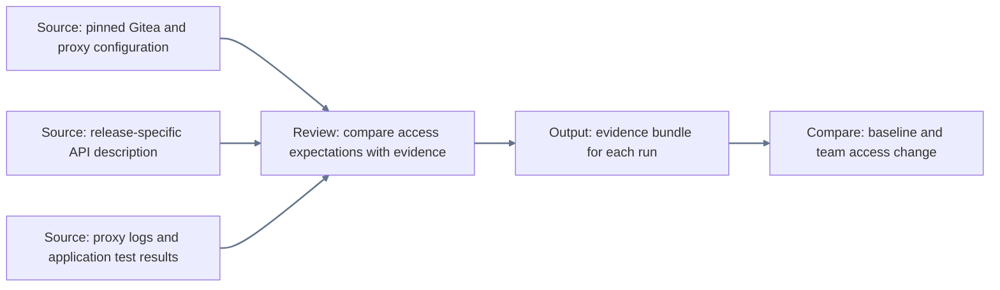

# Gitea benchmark

**Status: scaffolded.**[^status]

Evaluate an end-to-end evidence review for a pinned local instance. Compare the evidence before and after an intended team access change.

Use `deployment/` for the pinned setup, `fixtures/` for synthetic seed data and expected decisions, and a root `profile.json` for scoring once the profile format is defined.

[Baseline design](../../../research/08-policy-verification-design.md#baseline-applications)

## Scenario

**Proposed full-application baseline: Gitea.**[^full-app] Run a version-pinned instance with a database and a reverse proxy. Seed an organization, a team, one public repository, one private repository, and member and nonmember accounts with synthetic data. Use the application UI and documented API for ordinary browsing, repository reads, and membership changes. [Gitea API usage](https://docs.gitea.com/1.27/development/api-usage/), [Gitea reverse proxy guidance](https://docs.gitea.com/1.27/administration/reverse-proxies/)

| Review question | Evidence |
| --- | --- |
| What API operations are documented? | OpenAPI description exported from `/swagger.v1.json` on the pinned instance. |
| How do requests reach the app? | Reverse proxy configuration and application listener settings. |
| Which requests did the edge receive? | Proxy access logs from the seeded workflow. |
| Who could read each repository? | Independently labeled access expectations and ordinary application regression results for each account. |

[Mermaid source](../../../research/_references/diagrams/benchmarks/gitea/01-overview.mmd)

Capture a baseline, then make one intentional access policy change such as granting a team access to the private repository. Capture a new run and compare the evidence and coverage. Keep the manual inventory and expected role behavior as the benchmark reference.

[^status]: The README defines the benchmark. A runnable profile and inputs are pending.

[^full-app]: Gitea is a recommendation for the end-to-end Pensys exercise. The exact release, deployment inputs, and expected access matrix still need to be pinned and verified. An OpenAPI description covers documented API operations.
