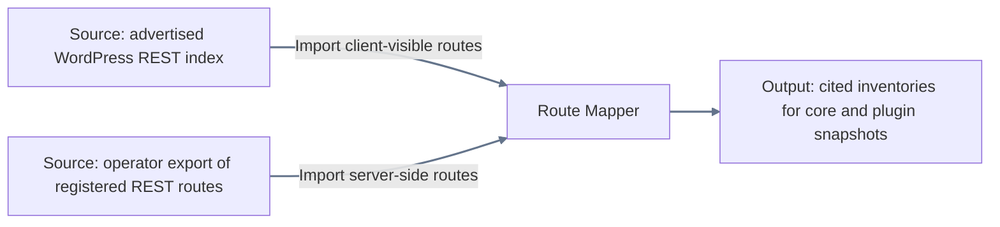

# WordPress benchmark

**Status: scaffolded.**[^status]

Compare the advertised and registered REST inventories for a pinned local instance, then repeat after adding one plugin.

Use `deployment/` for the core and plugin configurations, `fixtures/` for route exports and expected changes, and a root `profile.json` for scoring once the profile format is defined.

[Baseline design](../../../research/08-policy-verification-design.md#baseline-applications)

## Scenario

**Proposed WordPress route baseline:** Use a pinned, locally owned WordPress instance for route inventory and evidence coverage.[^wordpress] Its REST index exposes advertised routes and methods. An operator-side export from the WordPress REST server's registered route map provides the underlying route map. The REST index derives its advertised entries from that registry. Comparing the two measures visibility, scope, and import correctness. Compare the REST inventories separately from any ingress or access-log evidence. Keep the first snapshot core-only, then add one plugin in a new snapshot to test whether Diff can explain what changed. [WordPress REST index](https://developer.wordpress.org/rest-api/extending-the-rest-api/routes-and-endpoints/), [WordPress index implementation](https://developer.wordpress.org/reference/classes/wp_rest_server/get_index/)

[Mermaid source](../../../research/_references/diagrams/benchmarks/wordpress/01-overview.mmd)

[^status]: The README defines the benchmark. A runnable profile and inputs are pending.

[^wordpress]: This checks the portability of route and coverage evidence. It does not measure tenant policy correctness, and the REST index alone cannot establish the complete web surface.
