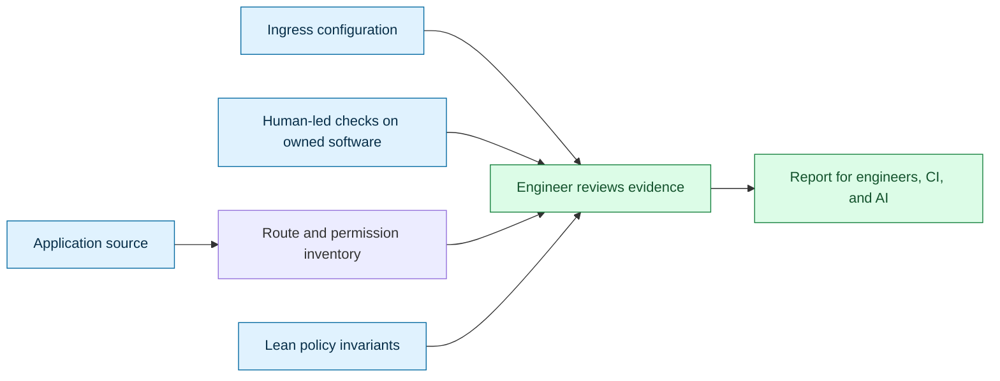

# Initial direction

[Mermaid source](_references/diagrams/01-initial-direction/01-overview.mmd)

- Build security review tools for personal and work projects that can run locally or in CI, with source evidence and reports that an AI can also read.
- Include human-led penetration-testing tools for owned software. Use local or authorized staging deployments to check expected security behavior, such as whether test accounts are denied access across tenants, whether private routes require authentication, and whether traffic follows the intended ingress. Record the expected and observed results for each check.
- Start with route inventory and ingress evidence. Record methods and handlers where available, and preserve gaps. **Authorization Review** can use this inventory for tenant and resource policy checks.[^direction]
- Prototype in Python. **Lean and Rust** are candidates for explicit policy invariants and performance-sensitive components, respectively.[^direction]
- Compare source-derived routes with deployed ingress configuration and approved staging checks. Measure coverage and review quality before using findings as CI gates.

See [Tool boundaries and shared evidence](06-tool-boundaries-and-evidence.md) for the current package plan.

[^direction]: Authorization Review and language choices beyond the Python prototype remain open. Lean would model policy invariants, with separate evidence required for deployed enforcement.
