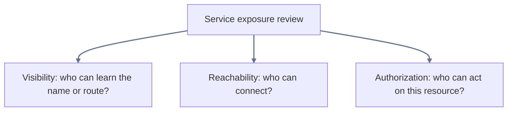
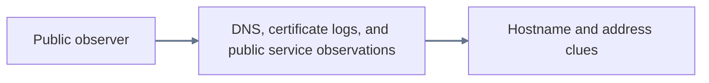
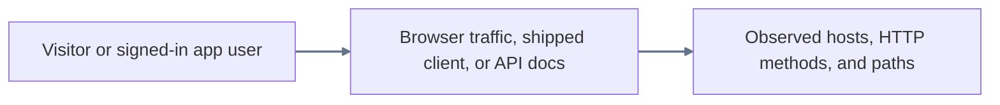
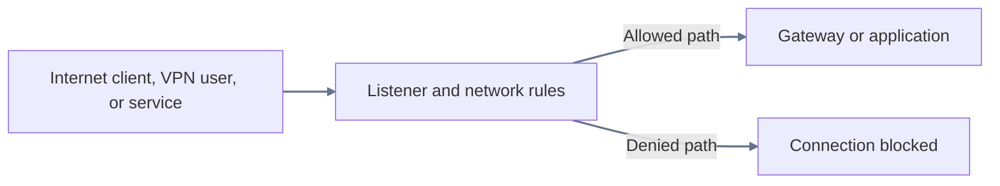
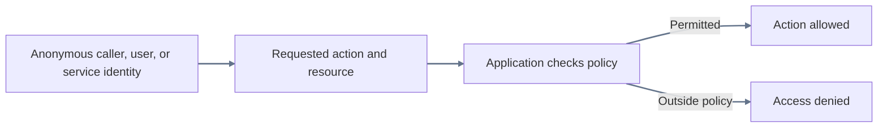

# How infrastructure and endpoints become visible

A service exposure review asks three questions about a service. Gather evidence for each and record who owns the relevant controls.

[Mermaid source](_references/diagrams/02-internet-exposure/01-overview.mmd)

## Visibility: who can learn the name or route?

### Hostnames and IP addresses

[Mermaid source](_references/diagrams/02-internet-exposure/02-hostnames-and-ip-addresses.mmd)

Public DNS can point to an edge, load balancer, or origin. Historical DNS and records outside the main proxy can disclose origin addresses. Certificate logs can reveal names associated with private services. Internet-wide observations can reveal a reachable service even when the observer starts without a name.

**Typical owner:** The platform operator manages public DNS, certificates, and public infrastructure. Record which source disclosed each name or address and when it was observed. [How Certificate Transparency works](https://certificate.transparency.dev/howctworks/), [Cloudflare guidance on public and historical DNS](https://developers.cloudflare.com/fundamentals/security/protect-your-origin-server/)

### API routes

[Mermaid source](_references/diagrams/02-internet-exposure/03-api-routes.mmd)

A web or mobile client can reveal the routes it uses. Partner integrations and documentation can reveal others. Compare those clues against the deployed route inventory, including older API versions, staging hosts, and routes absent from the current client.

**Typical owners:** Frontend and product teams manage what clients and docs publish. Backend and platform teams maintain the deployed route inventory. [Inspect browser network activity](https://developer.chrome.com/docs/devtools/network/), [OWASP API inventory management](https://api-security.owasp.org/editions/2023/en/0xa9-improper-inventory-management/)

## Reachability: who can connect?

[Mermaid source](_references/diagrams/02-internet-exposure/04-reachability-who-can-connect.mmd)

Define the caller's network location and the destination hostname, protocol, and port. Compare the intended access path with deployed listener settings, firewall rules, and private network or tunnel configuration. Record whether the evidence comes from configuration, logs, or an approved connectivity check.

**Typical owners:** Platform or networking teams manage gateways, network policy, and private connectivity. [Ingress deployment examples](03-ingress.md), [AWS Reachability Analyzer as a configuration-analysis example](https://docs.aws.amazon.com/vpc/latest/reachability/what-is-reachability-analyzer.html)

## Authorization: who can act on this resource?

[Mermaid source](_references/diagrams/02-internet-exposure/05-authorization-who-can-act-on-this-resource.mmd)

Review the server-side permission check for the requested action and resource. An endpoint can require a signed-in user and still need an object-level decision about which tenant owns the resource. Record the intended policy and the code or approved regression check that supports it.

**Typical owners:** Backend teams implement enforcement. Product or data owners define who should have access. [OWASP object-level authorization](https://api-security.owasp.org/editions/2023/en/0xa1-broken-object-level-authorization/)

## Example: staging invoices API

| Layer | Actor and observation | Typical owner |
| --- | --- | --- |
| Visibility | A public observer sees the staging hostname in a certificate log. A signed-in app user sees the invoice route in browser traffic. | Platform for certificate issuance. Frontend for client behavior. |
| Reachability | A caller on the public internet cannot connect to the private gateway. A user on an authorized VPN can connect if ingress rules allow it. | Platform or networking. |
| Authorization | A signed-in user from tenant A can reach the API, and the backend denies access to tenant B's invoice. | Backend for enforcement. Product or data owner for policy. |

For a personal project, one person may own all three layers. For a team deployment, record the actual owner for each layer. The [Edge Traffic Review design](_tools/edge-traffic-review/README.md) shows how operator-side access logs can be correlated with route, ingress, and origin evidence.
