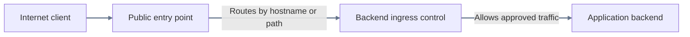
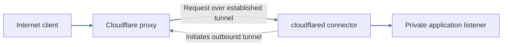
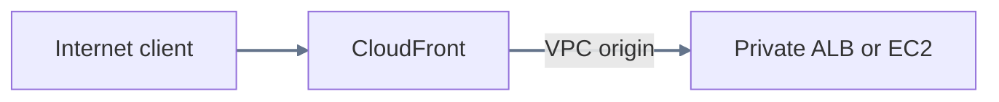
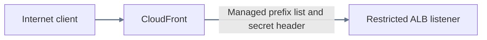
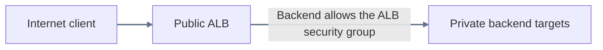
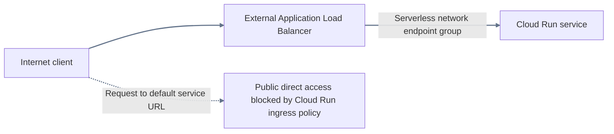
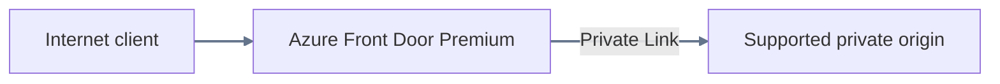
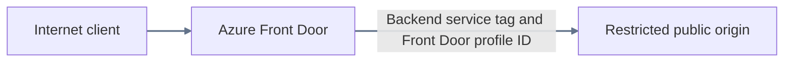
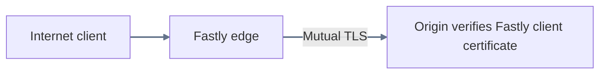
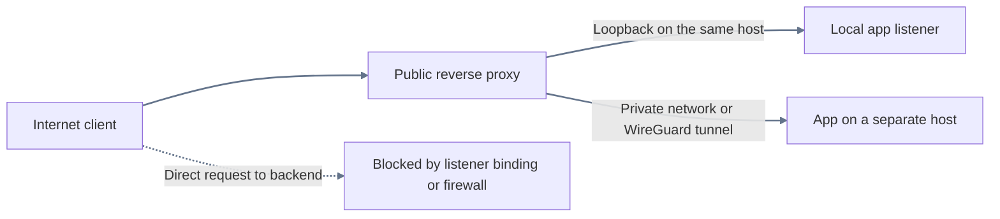

# Ingress

Ingress is the path incoming traffic takes to an application. The public entry point can be a CDN, a load balancer, an API gateway, or a reverse proxy. Each deployment defines which entry points clients should use and how those entry points reach the backend.

[Mermaid source](_references/diagrams/03-ingress/01-overview.mmd)

## Detailed ingress paths

### Cloudflare Tunnel

[Mermaid source](_references/diagrams/03-ingress/02-cloudflare-tunnel.mmd)

[Publish applications through Cloudflare Tunnel](https://developers.cloudflare.com/tunnel/)

### AWS: CloudFront and load balancers

#### CloudFront with a private origin

[Mermaid source](_references/diagrams/03-ingress/03-cloudfront-with-a-private-origin.mmd)

[CloudFront VPC origins](https://docs.aws.amazon.com/AmazonCloudFront/latest/DeveloperGuide/private-content-vpc-origins.html)

#### CloudFront with an internet-facing ALB

[Mermaid source](_references/diagrams/03-ingress/04-cloudfront-with-an-internet-facing-alb.mmd)

[Restrict ALB access through CloudFront](https://docs.aws.amazon.com/AmazonCloudFront/latest/DeveloperGuide/restrict-access-to-load-balancer.html)

#### Public ALB as the entry point

[Mermaid source](_references/diagrams/03-ingress/05-public-alb-as-the-entry-point.mmd)

[Application Load Balancer security groups](https://docs.aws.amazon.com/elasticloadbalancing/latest/application/load-balancer-update-security-groups.html)

### Google Cloud: external load balancer and Cloud Run

[Mermaid source](_references/diagrams/03-ingress/06-google-cloud-external-load-balancer-and-cloud-run.mmd)

[External Application Load Balancer with a Cloud Run backend](https://docs.cloud.google.com/load-balancing/docs/https/setup-global-ext-https-serverless)

This setup uses Cloud Run's **Internal and Cloud Load Balancing** ingress setting. Where compatible with the deployment, the default URL can also be disabled.

### Azure Front Door

#### Private origin through Private Link

[Mermaid source](_references/diagrams/03-ingress/07-private-origin-through-private-link.mmd)

[Private Link for Azure Front Door Premium](https://learn.microsoft.com/en-us/azure/frontdoor/private-link)

#### Restricted public origin

[Mermaid source](_references/diagrams/03-ingress/08-restricted-public-origin.mmd)

[Secure traffic to Azure Front Door origins](https://learn.microsoft.com/en-us/azure/frontdoor/origin-security)

### Fastly

[Mermaid source](_references/diagrams/03-ingress/09-fastly.mmd)

[Fastly mutual TLS to origin](https://www.fastly.com/documentation/solutions/examples/origin-mtls/)

### Self-managed reverse proxy

[Mermaid source](_references/diagrams/03-ingress/10-self-managed-reverse-proxy.mmd)

[NGINX reverse proxy module](https://nginx.org/en/docs/http/ngx_http_proxy_module.html), [WireGuard quick start](https://www.wireguard.com/quickstart/)

## Common setups

| Setup | Public entry point | Boundary to review |
| --- | --- | --- |
| Cloudflare | Cloudflare proxy | With Cloudflare Tunnel, the connector establishes an outbound connection. Check whether any origin listener is also publicly reachable. |
| AWS | CloudFront or an internet-facing Application Load Balancer (ALB) | CloudFront can use a private VPC origin. A public ALB can be the intended entry point, with backend security groups allowing traffic from the ALB. |
| Google Cloud (GCP) | External Application Load Balancer | For Cloud Run, check the service ingress policy and whether the default service URL provides another public path. |
| Azure | Azure Front Door | Check Private Link for supported origins or the access restrictions on public origins. |
| Other CDNs, such as Fastly | CDN edge | Check how the backend verifies traffic from the edge, for example with mutual TLS. |
| Self-managed | NGINX, Caddy, or HAProxy | A backend can listen on loopback, a private network, or a tunnel. Check listener bindings, firewall rules, and published container ports. |

For each deployment, record the expected hostname, public listener, routes, backends, and owner. Compare those expectations with deployed DNS, routing rules, and backend access controls. Include provider-generated hostnames and staging environments when looking for additional entry points.

See [Origin protection controls](04-origin-protection-controls.md) for details and provider documentation, and the [Exposure Review CLI](_tools/exposure-review-cli/README.md) for how the tool would compare intended and deployed ingress.

The [Ingress Review CLI design](_tools/ingress-review-cli/README.md) describes how to check these paths against deployed configuration.
