# Origin protection controls

An origin is the backend that receives traffic from a public edge or reverse proxy. Origin protection keeps public requests on the intended path so that edge controls such as a web application firewall or rate limits apply consistently.

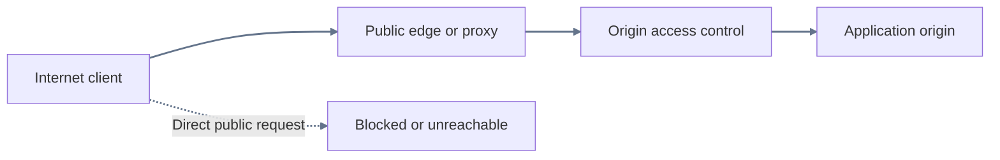

[Mermaid source](_references/diagrams/04-origin-protection-controls/01-overview.mmd)

## Managed services

### Cloudflare

#### Outbound tunnel

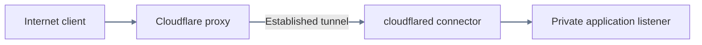

[Mermaid source](_references/diagrams/04-origin-protection-controls/02-outbound-tunnel.mmd)

The connector initiates the tunnel outbound. Review the application listener and firewall separately for unintended public access. [Cloudflare Tunnel](https://developers.cloudflare.com/tunnel/)

#### Public origin with Authenticated Origin Pulls

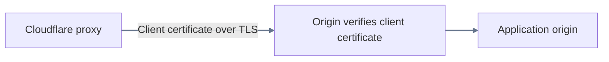

[Mermaid source](_references/diagrams/04-origin-protection-controls/03-public-origin-with-authenticated-origin-pulls.mmd)

Restrict ingress to the expected network sources and require client certificate verification. A shared Cloudflare certificate identifies the provider. A dedicated certificate can scope trust to your setup. [Cloudflare origin protection](https://developers.cloudflare.com/fundamentals/security/protect-your-origin-server/)

### AWS

#### CloudFront VPC origin

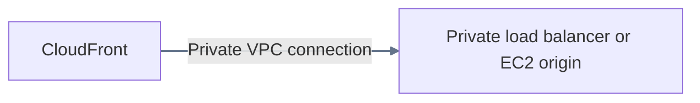

[Mermaid source](_references/diagrams/04-origin-protection-controls/04-cloudfront-vpc-origin.mmd)

Review the origin subnet, public address exposure, and origin security group. [CloudFront VPC origins](https://docs.aws.amazon.com/AmazonCloudFront/latest/DeveloperGuide/private-content-vpc-origins.html)

#### CloudFront with an internet-facing ALB

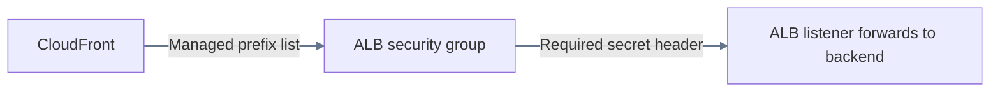

[Mermaid source](_references/diagrams/04-origin-protection-controls/05-cloudfront-with-an-internet-facing-alb.mmd)

The prefix list limits network sources to CloudFront origin-facing traffic. The listener checks the secret header before forwarding. When the public ALB itself is the intended entry point, restrict backend targets to traffic from the ALB security group. [Restrict ALB access through CloudFront](https://docs.aws.amazon.com/AmazonCloudFront/latest/DeveloperGuide/restrict-access-to-load-balancer.html), [ALB security groups](https://docs.aws.amazon.com/elasticloadbalancing/latest/application/load-balancer-update-security-groups.html)

#### Private S3 origin

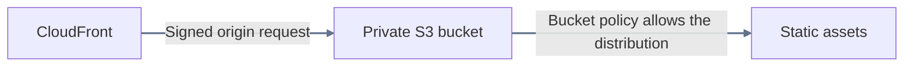

[Mermaid source](_references/diagrams/04-origin-protection-controls/06-private-s3-origin.mmd)

Use Origin Access Control with the S3 REST origin and scope the bucket policy to the intended distribution. [Restrict access to an S3 origin](https://docs.aws.amazon.com/AmazonCloudFront/latest/DeveloperGuide/private-content-restricting-access-to-s3.html)

### Google Cloud

#### Cloud Run behind a load balancer

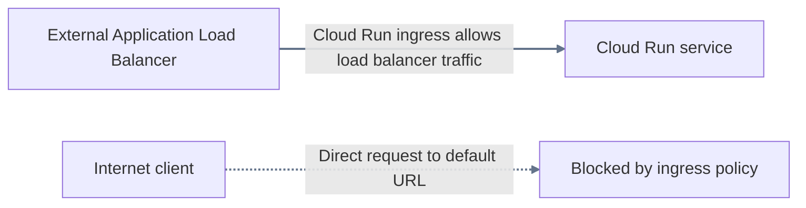

[Mermaid source](_references/diagrams/04-origin-protection-controls/07-cloud-run-behind-a-load-balancer.mmd)

Set Cloud Run ingress to Internal and Cloud Load Balancing. Review whether the default service URL can also be disabled without affecting required integrations. [Cloud Run ingress settings](https://docs.cloud.google.com/run/docs/securing/ingress)

### Azure

#### Front Door Premium with Private Link

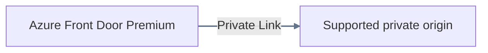

[Mermaid source](_references/diagrams/04-origin-protection-controls/08-front-door-premium-with-private-link.mmd)

Check that the private endpoint is approved and review whether public access remains enabled on the origin. [Azure Front Door Private Link](https://learn.microsoft.com/en-us/azure/frontdoor/private-link)

#### Front Door with a public origin

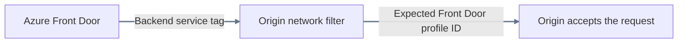

[Mermaid source](_references/diagrams/04-origin-protection-controls/09-front-door-with-a-public-origin.mmd)

Use the AzureFrontDoor.Backend service tag with a check for the expected X-Azure-FDID value. [Secure traffic to Azure Front Door origins](https://learn.microsoft.com/en-us/azure/frontdoor/origin-security)

### Fastly

#### Mutual TLS to the origin

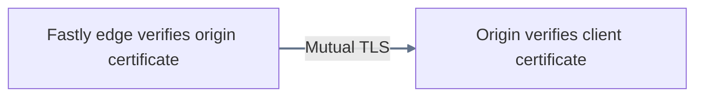

[Mermaid source](_references/diagrams/04-origin-protection-controls/10-mutual-tls-to-the-origin.mmd)

Review trusted client credentials at the origin and verify that the backend connection checks the origin certificate. [Fastly mutual TLS example](https://www.fastly.com/documentation/solutions/examples/origin-mtls/)

## Self-managed setups

#### Same-host reverse proxy

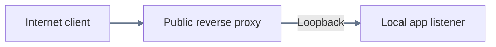

[Mermaid source](_references/diagrams/04-origin-protection-controls/11-same-host-reverse-proxy.mmd)

Review the actual bind address and published container ports. Reverse proxies such as NGINX, Caddy, and HAProxy can use this pattern. [NGINX reverse proxy module](https://nginx.org/en/docs/http/ngx_http_proxy_module.html)

#### Reverse proxy and origin on separate hosts

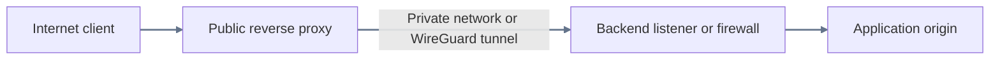

[Mermaid source](_references/diagrams/04-origin-protection-controls/12-reverse-proxy-and-origin-on-separate-hosts.mmd)

Bind the app to a private or tunnel interface, or restrict its firewall to the proxy. Mutual TLS can establish proxy identity when the origin requires it. [WireGuard quick start](https://www.wireguard.com/quickstart/), [NGINX TLS client verification](https://nginx.org/en/docs/http/ngx_http_ssl_module.html#ssl_verify_client)

## What the review tool should check

- Use the public listener-to-backend map from [Ingress Review](_tools/ingress-review-cli/README.md) to identify each origin, its owner, and the expected caller controls. Include provider-generated names, staging deployments, IPv6 listeners, and published container ports.
- Check that a direct public path cannot reach the same backend outside the intended edge. Compare deployed firewall and listener rules with infrastructure-as-code.
- Record where edge identity is enforced. Provider-wide IP ranges establish network source, while distribution-specific credentials or provider-enforced private connectivity can establish a narrower trust boundary.
- Flag controls based only on an unpublished hostname, an HTTP Host header, or an application port left publicly reachable behind a proxy. Track edge-to-origin TLS, origin access restrictions, and user authorization as separate controls.

See [Ingress](03-ingress.md) for traffic paths and [Ingress Review CLI](_tools/ingress-review-cli/README.md) for the configuration review design.

The [Origin Review CLI design](_tools/origin-review-cli/README.md) describes how to evaluate these controls against the intended edge-to-origin policy.
