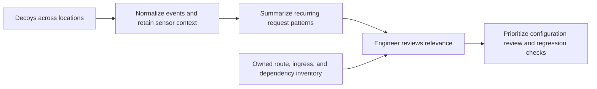

# Distributed honeypot telemetry

Source: Reddit post supplied in the discussion, describing a master's thesis project. **Self-reported figures.**[^source] The author reports 10 active sensors, one retired sensor, about 13.46 million events over 141 days, and about 558,000 web requests. Treat these as observations about those decoys and that collection period.

[Mermaid source](_references/diagrams/05-distributed-honeypot/01-overview.mmd)

## What carries over to our tooling

- The sensors received WordPress requests despite running no real WordPress. This is an example of generic probing. A request for a route is evidence of interest. Our own route and ingress inventory provides evidence about whether the route exists and is reachable.
- The author reports that 22.6% of observed IPs appeared on more than one sensor. Retain the sensor, protocol, timestamp, and exposure window when comparing patterns. Shared addresses and repeated signatures limit attribution, and sensor placement affects the counts.
- Use signature matches as triage evidence. A match suggests a possible attempt. Confirm relevance against our deployed dependency versions and exposure. CISA's KEV catalog can help prioritize relevant vulnerabilities.
- Start with existing edge logs and a route inventory. Compare aggregate traffic categories with known routes and intended ingress. Keep common events such as missing routes distinct from cases where a route or sensitive file was unexpectedly served.
- If we later add a decoy, decide what question its data should answer. Keep it isolated from the services being protected and restrict egress. Collect only the fields needed for the question, since raw headers and bodies can contain credentials or personal data.

## Connection to the Edge Traffic Review

Generic probes observed by the honeypot inform how the CLI groups edge traffic. The CLI compares those request patterns with our deployed ingress and route inventory so engineers can review evidence of unexpected exposure. Future honeypot summaries could provide an additional, separately labeled source. [Edge Traffic Review](_tools/edge-traffic-review/README.md)

## References

- [Original r/threatintel thread on the 10-sensor honeypot network](https://www.reddit.com/r/threatintel/comments/1xzrw0m/i_built_a_10_sensor_honeypot_network_for_my/)
- [CISA Known Exploited Vulnerabilities Catalog](https://www.cisa.gov/known-exploited-vulnerabilities-catalog)
- [Internet exposure](02-internet-exposure.md)
- [Origin protection controls](04-origin-protection-controls.md)

[^source]: The full report and underlying dataset were unavailable. The figures describe the author’s sensors and collection period.
