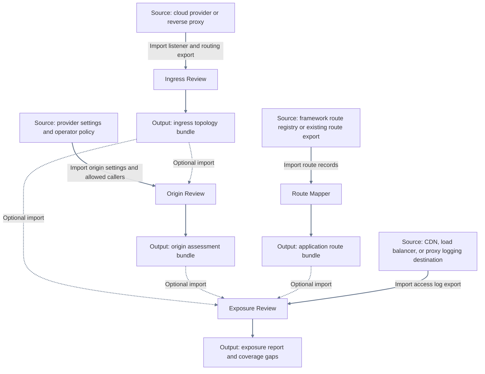
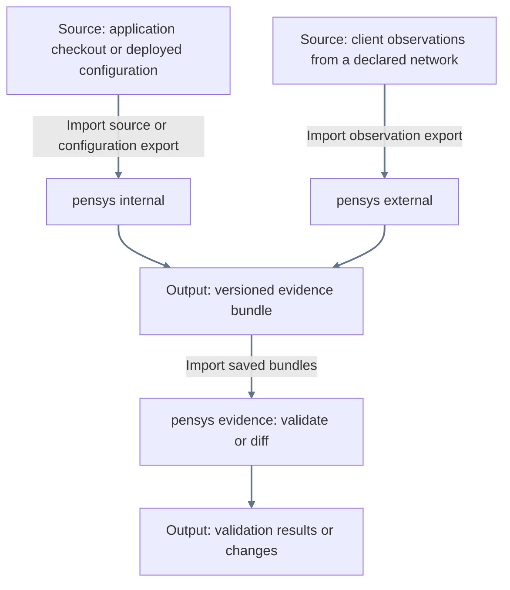
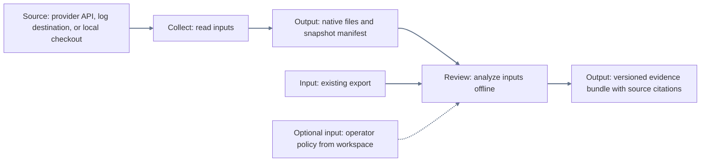
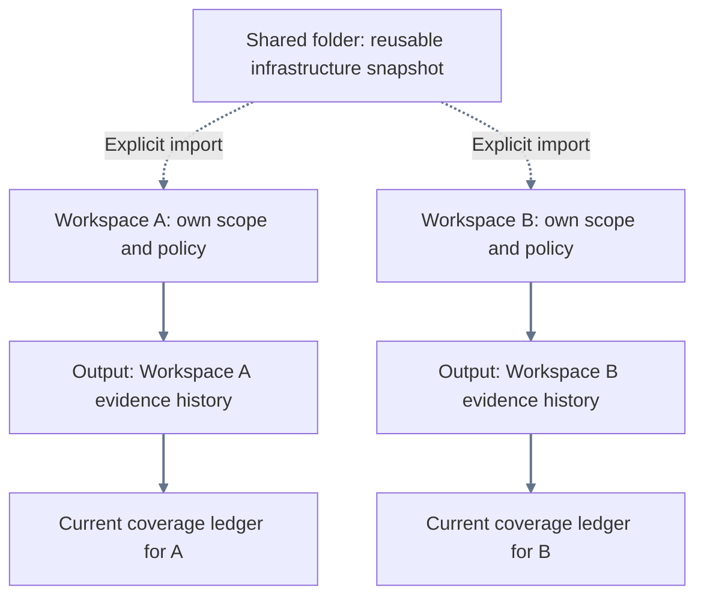
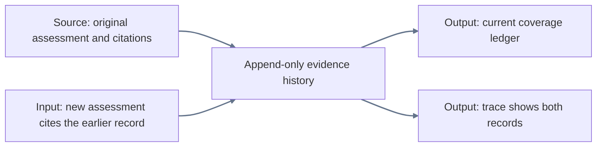
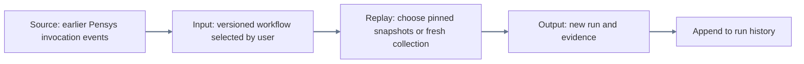

# Tool boundaries and shared evidence

**Design status:** The suite interfaces below describe planned behavior.[^implementation] Keep commands independently runnable. Package boundaries can follow implementation needs while command responsibilities and outputs stay distinct. Tools exchange versioned evidence files so a producer can be replaced, run at a different time, or implemented in another language. Keep the versioned interchange definitions in a shared `schema/` directory.



[Mermaid source](_references/diagrams/06-tool-boundaries-and-evidence/01-overview.mmd)

Prefer existing framework inventories, provider exports, and access logs. Each adapter should document what the upstream source exposes, what it omits, and what Pensys adds before a new collector or parser is built. [Route Mapper source inventory](_tools/route-mapper/README.md#what-existing-tools-expose)

## Who owns each decision?

| Component | Owns | Example output |
| --- | --- | --- |
| Ingress Review | Parsing provider configuration, mapping listeners to backends, and comparing configured network paths with intended ingress. | The app listens on all IPv4 interfaces. Public reachability is unresolved because firewall evidence is missing. |
| Origin Review | Evaluating origin controls against the intended edge identity and permitted sources. | The network filter is configured. Enforcement of the intended edge identity remains unresolved. |
| Exposure Review | Parsing and aggregating traffic, matching events to routes, and correlating them with available ingress and origin evidence. | The gateway forwarded a request for an unlisted path. The response status leaves the content uncertain. |
| Route Mapper | Extracting application routes from source or explicit exports and recording unresolved registrations. | An HTTP method and route template map to a handler at a specific revision. |
| Schema | Versioned record definitions and compatibility rules for producers and consumers. | A bundle identifies its producer, target scope, evidence records, and coverage gaps. |

Ingress Review describes configured paths. Origin Review evaluates whether those paths and the available origin controls enforce the expected trust boundary. Application permission checks belong with **Authorization Review** if that package is adopted.[^candidates] Exposure Review can cite results from either when they are relevant to an observed event.

Route Mapper and Ingress Review can run independently. Origin Review can use already supplied evidence, and Exposure Review can summarize traffic with missing supporting bundles. The arrows show optional evidence exchange between tools. Origin Review starts as a single evaluator with its own command. If it uses the same inputs and rules as Ingress Review, the two commands can ship in one package.

## Schema

The table describes the target contract. The implemented [v1 bundle schema](../schema/README.md) has string source locators and point timestamps. **Structured snapshot references, coverage windows, and review-question identifiers** are extensions.[^contract]

| Record | Minimum content |
| --- | --- |
| Bundle metadata | Schema version, producing tool and version, project and environment identifiers, and generation time. |
| Observation | Stable record ID within the bundle, record type, subject, value, source reference, and observation time or window. For a log aggregate, include the count and aggregation window. |
| Assessment | Claim or relationship, status such as supported or unresolved, and references to the observations behind it. Keep intended policy, observed facts, and inferences identifiable. |
| Coverage | Inputs and resources reviewed, time windows, and missing, unsupported, or out-of-scope inputs. |

Use JSON and JSON Schema for the initial interchange. Cross-bundle evidence references use a bundle ID and record ID. Correlate resources within the same project and environment using provider-scoped identifiers or explicit mappings. Match traffic using available host, method, route, and time evidence. Preserve ambiguity when multiple matches are possible. Keep raw configuration and sensitive log fields out of the shared bundle by default and cite the source or record location instead.

For example, Ingress Review can export the observed binding and its unresolved reachability assessment. Exposure Review can cite both records when explaining an edge event. A missing ingress bundle still allows a traffic summary, with ingress coverage marked as unavailable.

Trace is the precedent for normalizing imports, preserving provenance, and making inferred relationships reviewable. The audit skill's coverage ledger is the precedent for recording what a run actually examined. [Trace import model](https://github.com/phil-markarian/Trace/blob/7b49d40e0edfefc3b8fab450496f6af0bc68df42/src/services/import/types.ts), [Security audit workflow](https://github.com/phil-markarian/security-audit-skill/blob/c1c8a8c1471069fb0e188eeaff69b8e8db6564a8/README.md)

Schema defines the format. Evidence Validate checks bundle structure and cross-file references and scope. Evidence Diff and Trace reuse the same validation library. Review Log records execution events. Coverage in the evidence bundle is the downstream source for what was reviewed and what remains unresolved.

## CLI wrapper by analysis perspective

Use named entry points with thin dispatch. Repository scripts run as `./tool <script_name> [args...]`. Pensys commands resolve a named package entry point within a group, pass through arguments and exit status, and leave analysis to the package.

Use `pensys` as a working name. The agreed wrapper design groups independently runnable packages by evidence perspective. Internal analysis starts with implementation or operator-side evidence. External analysis starts with what a client can observe from a declared network and identity context.



[Mermaid source](_references/diagrams/06-tool-boundaries-and-evidence/02-cli-wrapper-by-analysis-perspective.mmd)

| Proposed command | Responsibility |
| --- | --- |
| `pensys internal routes` | Map source or route exports to handlers. |
| `pensys internal ingress` | Review deployed ingress configuration. |
| `pensys internal origin` | Review configured origin controls. |
| `pensys external visibility` | Review public DNS, certificate records, and client-visible evidence for owned assets. |
| `pensys external reachability` | Review approved connectivity evidence from a specified public network, VPN, or service context. |
| `pensys evidence validate` and `pensys evidence diff` | Validate and compare bundles from either perspective. |

Exposure Review correlates operator-side logs with available route, ingress, and origin evidence. A **suite-level `pensys review`** could also combine separately supplied client observations with those bundles.[^candidates] Edge logs are operator-side evidence of client traffic. Record the evidence source and observation context so a report can distinguish an operator's log from what a client received.

A vulnerability is a finding that can emerge from either perspective. A penetration test can also start from an authenticated session, a VPN, or other internal network access. The command names describe the evidence perspective. Authorization and test scope apply independently.

## Collection and review



[Mermaid source](_references/diagrams/06-tool-boundaries-and-evidence/03-collection-and-review.mmd)

Collectors read a local checkout, provider API, or configured log destination and save the inputs with a snapshot manifest. Reviewers accept an existing export or collected snapshot and write a versioned evidence bundle. Review can run offline with the same inputs.

- **Snapshot manifest:** Record the source and resource identifiers, workspace scope, collection time, included files, and coverage gaps. For logs, also record the requested time window and known sampling.
- **Snapshot files:** Preserve the source format so provider and framework adapters can interpret their own inputs.
- **Policy:** Read intended ingress or allowed callers from the operator's workspace. Treat this separately from observations of the deployed configuration.
- **Evidence bundle:** Cite the snapshot records behind observations and assessments.

Illustrative command syntax:[^implementation]

```sh
pensys internal ingress collect --workspace storefront --environment staging --out snapshots/ingress
pensys internal ingress review --workspace storefront --environment staging --input snapshots/ingress --out evidence/ingress.json
```

Standardize the manifest first. Add read-only connectors incrementally as each source is supported.

## Input sufficiency

Assess sufficiency per review question. A readable export can support one conclusion while leaving another unresolved. The owning review tool defines the evidence it needs. Evidence Validate checks the bundle and its references. Review reports use consistent labels for the resulting coverage.

| Signal | Example | What to do next |
| --- | --- | --- |
| Sufficient | An ALB export identifies a listener rule and its target group for the reviewed environment. | Use the export for that topology claim. |
| Partial | Access logs show method, path, and status but omit whether the edge forwarded the request. | Report traffic counts. Use backend or gateway evidence to assess forwarding. |
| Missing or inaccessible | Logging was disabled, the requested window was not retained, or the collector lacked permission. | Report the specific cause. Enable, retrieve, or request the appropriate existing source. |
| Stale or out of scope | The export is from a different environment, deployment revision, or time window. | Collect a comparable snapshot before making the claim. |
| Unsupported format | The upstream export contains the needed fields, but Pensys cannot read that format. | Add or extend an import adapter. Reuse the upstream exporter. |
| Upstream gap | Existing route exports omit HTTP methods and no scoped API specification is available. | Check the framework registry or another existing exporter. Build a narrow extractor if those sources cannot supply the missing evidence. |

Show the review question, source, covered scope and time window, missing fields or records, and the suggested next input. Record known sampling, truncation, or redaction when it affects the claim. Treat a missing or incomplete log window as a coverage gap even if it contains zero matching requests. Evidence Diff should carry these signals forward so a loss of coverage cannot look like a resolved finding.

## Next shared commands

- [Evidence Validate](_tools/evidence-validate/README.md): Check bundle structure, record references, and project and environment scope before combining evidence.
- [Evidence Diff](_tools/evidence-diff/README.md): Compare compatible runs and report changes in observations, assessments, and coverage. When an input is missing, mark the affected result as no longer evaluable rather than resolved.

Validate and Diff are the first shared commands. They operate on evidence bundles from any package. A later `pensys evidence trace <assessment-id>` command will follow citations and show which inputs are missing.

## Review workspace

Use a local project manifest to record review scope, expected policies, and paths to inputs and evidence bundles. The suite wrapper uses it to reopen a review, render existing results, or run selected packages with the same scope. Start with file references. Add archive export when a review needs to be handed off as a single file.

### Coverage history and shared folders



[Mermaid source](_references/diagrams/06-tool-boundaries-and-evidence/04-coverage-history-and-shared-folders.mmd)

Call the derived current view the **coverage ledger**. Retained bundles and append-only records supply its history. It tracks which review questions have sufficient evidence, which are still open, and what changed. Key each entry by workspace, environment, subject, and review question. Record the status and reason, evidence references, applicable revision or time window, and next input when needed.

Keep historical evidence bundles and derive the current coverage view from them. Reuse prior evidence when it still applies to the question and the inputs that support it. A changed deployment or an expired log window can reopen a question without losing the earlier result. When the ledger has no usable evidence, show the gap and the input needed to close it.

A suite home can contain multiple independent workspace folders and a shared folder. Each workspace owns its manifest, policies, snapshots, evidence, and logs. The shared folder can hold schemas, adapters, policy templates, and explicitly referenced snapshots of shared infrastructure. A shared snapshot retains its original scope and provenance. Each workspace declares which resource it uses from that snapshot and records its own assessment. Keep access to shared snapshots explicit.

Version independently:

- **Schema version:** Determines whether a consumer can read the artifact.
- **Tool and rule version:** Identifies how an assessment was produced.
- **Input revision or snapshot ID:** Identifies what was reviewed and helps determine whether the result still applies.

Start with files and manifest references. Generate the current ledger view from retained bundles before adding a database or synchronization service.

### Example workspace layout

```text
pensys-home/
  shared/
    policy-templates/
    workflows/
    snapshots/
      edge-001/
        manifest.json
        files/
  workspaces/
    storefront/
      workspace.json
      policies/
      workflows/
      snapshots/
        routes-001/
          manifest.json
          files/
      runs/
        run-001/
          events.jsonl
          evidence/
            routes.json
            ingress.json
      coverage/
        current.json
    billing/
      workspace.json
```

- **Workspace manifest:** Declares the project, environments, policy files, and the shared snapshots the project uses. Both workspace manifests can reference `edge-001` while declaring their own environment and resource scope. Preserve the snapshot's original provenance.
- **Snapshot manifest:** Records its snapshot ID, original source, collection scope and time, and native input files. Evidence cites the snapshot ID and a record location within it. A later collection gets a new snapshot ID so old citations remain meaningful.
- **Run folder:** Keeps the log and evidence emitted by that run together. Evidence bundles cite other bundles using bundle and record IDs. A workspace can reuse an earlier bundle when it still applies to the current inputs and policy.
- **Coverage ledger:** `coverage/current.json` is a regenerable view over applicable evidence bundles. Each row points back to a bundle and records its scope, status, and missing input if any. Keep prior bundles as the history and regenerate the ledger when evidence changes.

Share raw snapshots explicitly in the manifest. Keep assessments and coverage with the workspace whose scope and policy they reflect. Resolve snapshot IDs through the workspace manifest so moving the suite home does not break references.

### Identifier generation convention

Use UUIDv7 for newly created workspace, snapshot, run, and evidence bundle IDs. Independent tools can generate these IDs locally, and workspaces can share or import artifacts without coordinating a counter. Use the canonical lowercase, hyphenated string for serialized IDs and generated folder names. Preserve existing IDs on import. Keep human-readable workspace names and labels in their manifests.

Evidence references continue to use a bundle ID and a bundle-local record ID. For Diff and the coverage ledger, compare a stable subject and review question within the same scope. A generated artifact ID identifies one artifact and will change on a new run. Use recorded timestamps when interpreting chronology across hosts.

The numbered folder names above are illustrative. Apply UUIDv7 to new artifacts through a shared generation convention. Keep v1 readers compatible with existing example IDs. [RFC 9562: UUID version 7](https://www.rfc-editor.org/rfc/rfc9562.html#name-uuid-version-7)

### Append-only evidence history



[Mermaid source](_references/diagrams/06-tool-boundaries-and-evidence/05-append-only-evidence-history.mmd)

Evidence accumulates across runs and investigations. Once recorded, preserve each observation, assessment, source reference, and user link. A correction, retraction, or changed conclusion adds a timestamped record with its own ID, the earlier record it supersedes, the author or tool, and the reason. Contradictory observations can coexist with their original scope and provenance.

The current coverage ledger and workspace index are derived views. They can be rebuilt from the history. A later finding can become resolved, stale, or unresolved while the earlier record remains traceable. Moving or sharing an artifact preserves its identity and history. If a referenced input is unavailable, record that gap explicitly.

### Evidence links and portability proposal

**Investigation links and portable export** are proposed.[^portability]

Use a workspace-local investigation manifest to group evidence by reference. Give each investigation a UUIDv7, a readable title, and a scope. An investigation references existing bundles and records by bundle ID and record ID. A workspace index resolves bundle and snapshot IDs to relative file paths and can be rebuilt from artifact manifests. Moving a file updates its location in the index while its citations retain the same IDs.

- **Connect:** A proposed `pensys evidence link` command writes a relationship record with its own UUIDv7, the two references, a relationship type such as supports or contradicts, an explanation, an author, and a timestamp. Save user annotations alongside the investigation. Preserve original tool output and supersede earlier links with new records when a reviewer revises a decision.
- **Move or share:** Export an investigation manifest and the evidence it references, including the selected snapshot files needed to reproduce a conclusion. Include a checksum per exported file. List excluded or unavailable dependencies explicitly so the recipient can see the resulting gaps. Import preserves IDs and original provenance. Identical content can be reused. The same ID with different content is a conflict to report before merging.
- **Check consistency:** Validate reference targets and scope before linking or merging. Permit explicit cross-investigation references within compatible scope and identify any scope mismatch. Keep version and freshness information attached to the original evidence. `pensys evidence trace` can display the linked records, author notes, and missing dependencies.

Start with link records and a rebuildable local index. Add portable export when users need to hand off an investigation. A checksum verifies file consistency against the export manifest. It does not establish authorship. [Trace case storage and export](https://github.com/phil-markarian/Trace/blob/7b49d40e0edfefc3b8fab450496f6af0bc68df42/README.md#local-first), [Trace import model](https://github.com/phil-markarian/Trace/blob/7b49d40e0edfefc3b8fab450496f6af0bc68df42/src/services/import/types.ts)

### Storage design and evaluation

**Storage techniques under evaluation** include content addressing, columnar caches, and indexed search.[^storage]

Treat storage as a core workspace concern. Measure how storage choices affect ingest, lookup, diff, replay, sharing, and recovery. Preserve artifact IDs, citations, append-only history, and portable workspaces as storage implementations evolve.

Start with native files and rebuildable indexes. Evaluate additional techniques against representative workloads:

| Workload | Candidate technique |
| --- | --- |
| Derived snapshots repeat large inputs | Store immutable file contents by hash and let multiple snapshot manifests reference the same content. Keep snapshot UUIDs and collection provenance independent of content hashes. |
| Reviews scan large access-log windows | Evaluate compressed, time-partitioned files or a derived columnar cache for repeated aggregation. Retain the original export and its record references. |
| Index refreshes become expensive | Index new artifacts incrementally. Measure full rebuild and recovery as well as steady-state performance. |
| Reviewers miss related findings in keyword search | Compare exact lookup, full-text search, and semantic retrieval using the same review questions. |

Record ingest throughput, query latency, disk usage, and index rebuild time. Include workspace export and offline replay in the evaluation so a speed gain does not come at the cost of portability or reproducibility. Add new storage mechanisms when measurements show a clear benefit for a real workload.

### Search indexes

Keep native inputs and append-only evidence in workspace files. Use a workspace-local, rebuildable SQLite index when scanning those files becomes slow. Index artifact locations, record IDs, citations, and current coverage. Index full text when keyword search is needed. Track which files have already been indexed so refreshing the index can process new artifacts incrementally.

**Vector search** is a candidate once an evaluation shows that semantic retrieval finds useful related evidence that exact and keyword search miss.[^storage] Start with a local index before introducing a separate database service. Store each embedding's record reference, source revision, and model version. A search hit is a lead for the reviewer. Any evidence link based on it requires an explicit assessment. Apply workspace scope to index queries and share only explicitly imported evidence across workspaces.

SQLite can also support:

- **Evidence lookup:** Find an artifact's citations and reverse links, including which investigations use it.
- **Coverage queries:** Filter unresolved questions by workspace, environment, owner, missing input, or age when those fields are available.
- **Impact review:** Find the assessments tied to a changed snapshot, policy, or rule version.
- **Integrity and recovery:** Detect duplicate IDs, surface unresolved references, and commit a batch of index updates together so a failed refresh can resume.

### Command history and reusable workflows



[Mermaid source](_references/diagrams/06-tool-boundaries-and-evidence/06-command-history-and-reusable-workflows.mmd)

Record Pensys command invocations as structured run events. Capture the command name, workspace and environment, safe arguments, tool version, input snapshot IDs, output bundle IDs, timestamps, and outcome. Keep the record even when a command fails. Capture Pensys commands only and omit credentials and sensitive argument values.

Let an operator select steps from the history and save a named, versioned workflow file. Each step names a registered command, declares its inputs, and can reference outputs from earlier steps. Use parameters for project and environment settings so the workflow can be reused. Distinguish pinned snapshots for reproduction from fresh collection for a new review. Show the planned steps before replay and write a new run with its own UUIDv7 and a reference to the workflow version. Prior runs and their evidence remain traceable.

Invocation capture and the choice between pinned inputs and fresh collection are agreed. To adjust a workflow, save a new revision or branch that records its parent revision. It can reuse pinned inputs and reorder, add, or replace steps. Keep past runs tied to the exact workflow revision and snapshot IDs they used.

To add material to a snapshot, create a derived snapshot with a new UUIDv7. Record its parent, added files, and any explicit overrides used by the new review. Preserve the source, scope, and collection time of each input. For example, extend a Django route listing with an OpenAPI export and rerun Route Mapper using the derived snapshot. The earlier snapshot still reproduces the earlier review.

Store personal workflows under a workspace's `workflows/` folder. Put reusable templates under `shared/workflows/` and keep workflow run records in the workspace that executed them.

## Candidate entry points

**Authorization Review and Asset Inventory** are proposals.[^candidates]

- **Authorization Review:** Compare intended role, tenant, and resource permissions with server-side checks and results from existing regression tests. Route Mapper supplies route and handler references.
- **Asset Inventory:** Import owned domains, certificates, and cloud resources from authoritative exports. Record the owner and environment. Ingress Review uses that inventory to scope its review.

## Related designs

- [Ingress Review CLI](_tools/ingress-review-cli/README.md)
- [Exposure Review CLI](_tools/exposure-review-cli/README.md)
- [Origin Review CLI](_tools/origin-review-cli/README.md)
- [Shared review log](_tools/review-log/README.md)
- [Route Mapper](_tools/route-mapper/README.md)
- [Schema patterns from Trace and security-audit-skill](_tools/schema/README.md)


[^implementation]: The repository contains the v1 schema and fixtures plus a diagram maintenance command. The named Pensys commands and workspace behavior are designs. Adapter availability and CLI syntax need implementation and verification.
[^contract]: A later schema revision should define these fields and their compatibility rules. UUIDv7 is the convention for new artifact IDs. The existing v1 schema accepts string IDs, including the illustrative fixtures.
[^candidates]: These are optional extensions. Their package boundaries and CLI surfaces depend on demonstrated workflows.
[^portability]: Import conflict handling, artifact resolution, and dependency selection need an implementation and round-trip tests.
[^storage]: SQLite is the first indexing candidate. Introduce additional storage mechanisms after benchmarks show a benefit and replay and portability checks pass.
