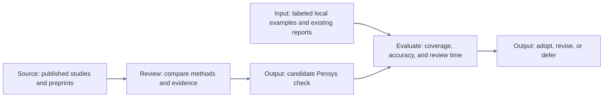

# Defensive security analysis research

First pass, November 19, 2026. This review uses primary papers and a provider engineering report. The focus is on methods Pensys can use to review owned systems and judge the quality of its findings.

[Mermaid source](_references/diagrams/07-defensive-analysis-research/01-overview.mmd)

## What the studies measured

| Study | Method and evidence | Implication for Pensys |
| --- | --- | --- |
| SymCert, 2026. [Paper and abstract](https://www.amazon.science/publications/symcert-verifying-smt-based-policy-analyses) | Implements verified symbolic analyses of Cedar policies in Lean and reports executable models used for prototyping and differential testing. | Model one explicit authorization invariant and compare model decisions with existing application regression tests. Store model and application evidence separately. |
| Formally Verified Cloud-Scale Authorization, 2025. [Full paper](https://assets.amazon.science/bb/40/22ac44f84f6d8eb625ac9666a00f/formally-verified-cloud-scale-authorization.pdf) | AWS reports verifying a replacement authorization engine against a specification and comparing its behavior with the predecessor on roughly one quadrillion production samples. | A verified model and implementation comparisons answer different questions. Use a small labeled policy fixture before investing in formal proofs. The vendor's deployment evidence is specific to its engine. |
| Debugging Network Reachability with Blocked Paths, 2021, with a 2026 AWS follow-up on segmentation. [Paper](https://link.springer.com/chapter/10.1007/978-3-030-81688-9_39), [Engineering report](https://www.amazon.science/blog/using-mathematics-to-validate-network-configurations) | Models reachability from configuration and explains which rules block a modeled path. The newer report describes applying automated reasoning to deployed Cloud WAN segmentation. | Import existing analyzer results where available. Keep the path, decisive rules, snapshot, and unsupported hops as evidence. Analyzed configuration and observed runtime behavior are distinct inputs. |
| LLM-based Vulnerability Detection at Project Scale, 2026. **Preprint.**[^preprints] [Study](https://arxiv.org/abs/2601.19239) | Evaluates five LLM methods and two traditional tools on 222 known C/C++ and Java vulnerabilities. The authors also manually reviewed 385 warnings from 24 active projects and report high false discovery rates for many tools. | Require source citations and measure reviewer time and false alarms. **Transfer to Django, Vue, and Go is unverified.**[^transfer] |
| Representation Matters, 2026. **Preprint.**[^preprints] [Study](https://arxiv.org/abs/2606.25356) | Compares raw C/C++ source with syntax, control-flow, and dependency representations. The authors report a better accuracy-overhead tradeoff for selected structural inputs in their benchmark. | Compare raw files with a short, cited route and permission trace when evaluating optional AI assistance. Start with data already available from framework exports and static analysis. **Transfer to Pensys is unverified.**[^transfer] |
| Should We Evaluate LLM Based Security Analysis Approaches on Open Source Systems?, ASE 2025. [Full paper](https://teamscale.com/hubfs/Publications/ASE_2025_vulnerability_detection.pdf) | Compares five models across open-source and one closed-source dataset. The authors report an approximately 20-point drop in recall across those datasets and explicitly limit generalization. | Include held-out representative code and known-good controls in local evaluations. Report dataset and scope alongside any accuracy claim. |

## First comparison to run

**Candidate:** Start with one tenant-isolation policy and one ingress topology, both captured in offline fixtures.[^local] Compare a documented manual review with a report assembled from native exports and existing regression outcomes. Include a complete snapshot, an intentionally incomplete export, and a new revision that changes the expected assessment.

Measure which review questions can be answered, false alarms against labeled examples, and time to verify citations. Track cases where the report correctly stays unresolved. Add Lean or AI-assisted analysis as separate comparisons after measuring that baseline.

See [Input sufficiency](06-tool-boundaries-and-evidence.md#input-sufficiency), [Route Mapper sources](_tools/route-mapper/README.md#what-existing-tools-expose), and [Origin Review](_tools/origin-review-cli/README.md).

[^preprints]: Results are from the authors' public preprints. This pass did not independently reproduce them.
[^transfer]: The study populations and language stacks differ from the intended Pensys applications. Evaluate locally before treating the reported gains as transferable.
[^local]: This is an evaluation design. No Pensys benchmark has been run.
