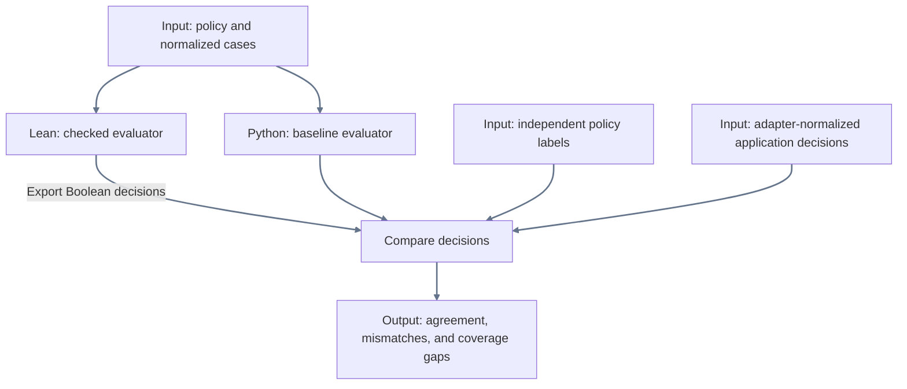
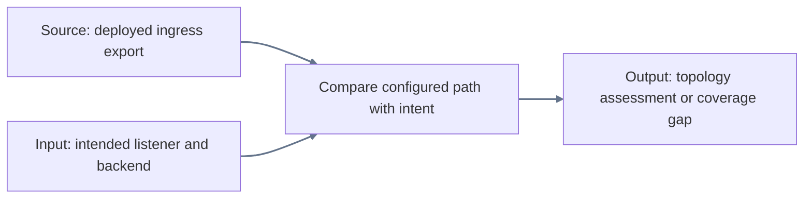

# Policy verification benchmark design

**Proposed design.**[^status] Use Lean to model one tenant authorization policy and prove an invariant about the model. Use a small Python harness to compare expected decisions with framework-neutral decision observations from existing regression tests. Keep the ingress comparison separate so it can run using configuration exports and existing analyzer evidence.



[Mermaid source](_references/diagrams/08-policy-verification-design/01-overview.mmd)

## First benchmark

| Part | Inputs | Output |
| --- | --- | --- |
| Lean policy model | Unlabeled requests and a written policy for reading a tenant-owned invoice. Define the actor, action, resource, tenant, and any permitted exception. | An executable allow/deny decision and a proof that a cross-tenant read requires an explicit exception in the model. |
| Application comparison | Independent policy labels, Lean decisions, and existing application regression results keyed by case ID and revision. Use the shared case and observation format below. | Matches, mismatches, or unresolved cases when application evidence is missing or incompatible. |

## Portable cases and adapters

Define cases independently of the application framework. Each case has a stable ID, actor and tenant, action, resource and tenant, applicable grant, and an expected decision labeled from the written policy. Pin the policy, model, application, test, and fixture revisions in the benchmark inputs.

An application evidence adapter maps an existing regression result to the case ID, relevant revision identifiers, and an observed allow or deny decision. A passing assertion can supply the decision when it identifies the actor, resource, fixture, and asserted outcome. For an HTTP denial that can also indicate missing data, require fixture evidence or an authorized positive control that establishes the resource exists. Skipped tests, ambiguous outcomes, and incompatible revisions produce unresolved assessments with a specific blocker. Other applications can feed the same observation format through an adapter or a native export. The harness compares decisions without interpreting framework-specific response codes or test runner statuses.

## Dependent types in the Lean model

Define `CanRead policy request : Prop` from the written policy. A same-tenant read must meet its ordinary authorization requirements. A cross-tenant read must have a valid grant scoped to the actor, action, resource, and relevant time. Define those requirements independently of the decision function.

Use Lean's built-in `Decidable (CanRead policy request)` as the dependent return type of the executable evaluator. Export the Boolean decision from that evaluator and prove that an exported allow on a cross-tenant request implies an active scoped grant. The proposition remains independent of the evaluator. A custom type is only a candidate if a consumer needs a verified grant identifier or denial reason.[^decision-review]

Accept well-formed requests from both authorized and unauthorized actors so denied cases reach the evaluator. Keep parsing failures and missing application evidence distinct from a modeled denial. Define the isolation theorem over the independent allow relation and connect it to the evaluator's result. This keeps the model from treating the expected answer as an input.

The Python baseline checks labeled decisions and application evidence. Lean provides a machine-checked guarantee for every modeled request. The exported allow decision implies the policy proposition and the cross-tenant isolation invariant.

## Proof and benchmark checks

Define an active, scoped exception independently of the decision function. Prove the invariant about the same executable Lean decision function the harness calls. Pin the Lean toolchain and cite the checked theorem. Export the decision as a Boolean and record proof verification separately. Require a proof without placeholders or benchmark-added axioms. Use policy-labeled witnesses for same-tenant allow and cross-tenant deny. If the policy allows exceptions, include a valid exception allow and an invalid or out-of-scope exception deny. These witnesses catch a model that denies every request while satisfying the isolation invariant.

Compare manual review, an executable Python policy model, and Lean plus the comparison harness on identical inputs. Include matched decisions, a known mismatch, missing evidence, and a revision change. Record correct answers, false alarms, false reassurance, correctly unresolved cases, and time to verify citations. Track model and adapter maintenance effort when judging the value of Lean.

The proof establishes a property of the Lean model. Application evidence establishes agreement for the cases actually reviewed. In a [v1 evidence bundle], record proof verification and application decisions as separate observations with source locators. A supported or mismatched comparison cites both expected and observed records. An unresolved comparison cites available records and names the blocker. Compare pinned revisions in the harness. The planned [Evidence Diff](_tools/evidence-diff/README.md) and coverage ledger can use that history when available.

Record independent labels, Lean decisions, and application observations separately. Investigate disagreements with a label even if the application and model agree. The proposed [Evidence Evaluate command](_tools/evidence-evaluate/README.md) can reuse this benchmark as its first profile.

## Ingress comparison



[Mermaid source](_references/diagrams/08-policy-verification-design/03-ingress-comparison.mmd)

## Baseline applications

Use the planned invoice application fixture for the policy comparison. Use representative applications to evaluate whether the same evidence workflow transfers across deployments and export formats. The [benchmark catalog](../benchmarks/catalog.json) lists the chosen scenarios, their definitions, and current status.

## Repository layout

**Scaffolded layout with planned inputs.**[^layout]

```text
benchmarks/
  policy/
    README.md
    profile.json
    fixtures/
    lean/
  apps/
    gitea/
      README.md
      profile.json
      deployment/
      fixtures/
    wordpress/
      README.md
      profile.json
      deployment/
      fixtures/
schema/
  evidence-bundle/
    schema.json  # Link to the current major
    v1/
      schema.json
      fixtures/
tests/
  integration/
```

Keep benchmark definitions, pinned deployment configuration, synthetic seed data, expected outcomes, and scoring profiles in each benchmark folder. Keep one profile at the root of each benchmark. Use the [benchmark catalog](../benchmarks/catalog.json) to find each definition. Add further subfolders only when needed. Keep unit tests with their owning packages and use root `tests/integration/` for cross-package checks. Keep minimal interchange examples beside each [schema release](../schema/README.md#release-layout).

Write collected snapshots, logs, evidence bundles, and evaluation results to a [Pensys workspace](06-tool-boundaries-and-evidence.md#example-workspace-layout). Commit small sanitized inputs or golden outputs only when they are part of a reproducible fixture. Reusable models and harness code belong in their owning packages when they have a second caller. Benchmark-only entry points can live alongside their cases.

See the [defensive analysis research] and [SymCert] for the precedent behind this split.

[v1 evidence bundle]: ../schema/README.md
[defensive analysis research]: 07-defensive-analysis-research.md
[SymCert]: https://www.amazon.science/publications/symcert-verifying-smt-based-policy-analyses

[^status]: The Lean model, harness, and labeled inputs are proposals. No implementation or benchmark results exist yet.

[^decision-review]: Sol high recommended the built-in dependent decision type for binary outcomes. A Boolean evaluator with a checked equivalence theorem can provide the same logical guarantee. The dependent signature carries the contract at the Lean interface. Parsing, adapter behavior, source provenance, and application correspondence require separate checks.


[^layout]: The benchmark READMEs and local directories are scaffolded. Profiles, fixtures, and deployment files are pending. Empty directories appear in Git once they contain tracked files.
