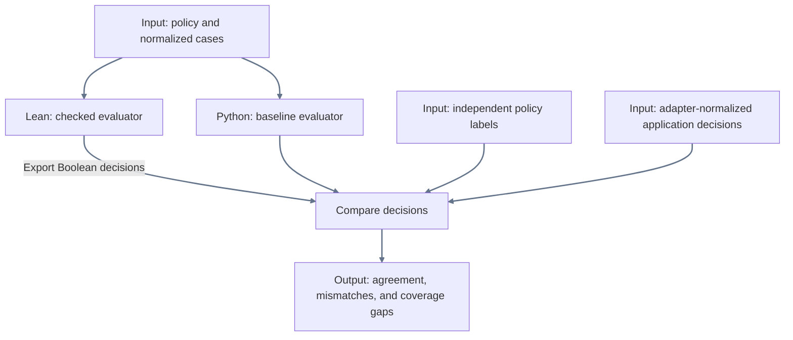
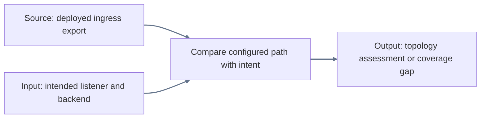
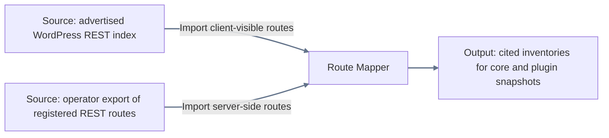
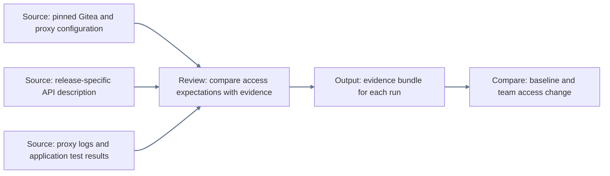

# Policy verification benchmark design

**Proposed design.**[^status] Use Lean to model one tenant authorization policy and prove an invariant about the model. Use a small Python harness to compare expected decisions with framework-neutral decision observations from existing regression tests. Django is the first evidence adapter. Keep the ingress comparison separate so it can run using configuration exports and existing analyzer evidence.



[Mermaid source](_references/diagrams/08-policy-verification-design/01-overview.mmd)

## First benchmark

| Part | Inputs | Output |
| --- | --- | --- |
| Lean policy model | Labeled cases and a written policy for reading a tenant-owned invoice. Define the actor, action, resource, tenant, and any permitted exception. | An executable allow/deny decision and a proof that a cross-tenant read requires an explicit exception in the model. |
| Application comparison | Lean decisions and existing Django regression results keyed by case ID and revision. Use the shared case and observation format below. | Matches, mismatches, or unresolved cases when application evidence is missing or incompatible. |
| Ingress comparison | Intended listener-to-backend path and a deployed configuration export. | Supported topology claims, mismatches, and unresolved paths where relevant settings are absent. |

### Ingress comparison



[Mermaid source](_references/diagrams/08-policy-verification-design/03-ingress-comparison.mmd)

## Baseline applications

Use the planned small Django invoice fixture for the Lean policy comparison. Its tenant rule gives the model and application the same explicit behavior to check.

**Proposed WordPress route baseline:** Use a pinned, locally owned WordPress instance for route inventory and evidence coverage.[^wordpress] Its REST index exposes advertised routes and methods. An operator-side export from the WordPress REST server's registered route map provides the underlying route map. The REST index derives its advertised entries from that registry. Comparing the two measures visibility, scope, and import correctness. Compare the REST inventories separately from any ingress or access-log evidence. Keep the first snapshot core-only, then add one plugin in a new snapshot to test whether Diff can explain what changed. [WordPress REST index](https://developer.wordpress.org/rest-api/extending-the-rest-api/routes-and-endpoints/), [WordPress index implementation](https://developer.wordpress.org/reference/classes/wp_rest_server/get_index/)

### WordPress route evidence



[Mermaid source](_references/diagrams/08-policy-verification-design/04-wordpress-inventory.mmd)

### Gitea evidence flow

**Proposed full-application baseline: Gitea.**[^full-app] Run a version-pinned instance with a database and a reverse proxy. Seed an organization, a team, one public repository, one private repository, and member and nonmember accounts with synthetic data. Use the application UI and documented API for ordinary browsing, repository reads, and membership changes. [Gitea API usage](https://docs.gitea.com/1.27/development/api-usage/), [Gitea reverse proxy guidance](https://docs.gitea.com/1.27/administration/reverse-proxies/)

| Review question | Evidence |
| --- | --- |
| What API operations are documented? | OpenAPI description exported from `/swagger.v1.json` on the pinned instance. |
| How do requests reach the app? | Reverse proxy configuration and application listener settings. |
| Which requests did the edge receive? | Proxy access logs from the seeded workflow. |
| Who could read each repository? | Independently labeled access expectations and ordinary application regression results for each account. |



[Mermaid source](_references/diagrams/08-policy-verification-design/02-gitea-evidence.mmd)

Capture a baseline, then make one intentional access policy change such as granting a team access to the private repository. Capture a new run and compare the evidence and coverage. Keep the manual inventory and expected role behavior as the benchmark reference. WordPress remains a useful second application for REST discovery and plugin-driven changes.

## Repository layout

**Scaffolded layout with planned inputs.**[^layout]

```text
benchmarks/
  policy/
    README.md
    profile.json
    fixtures/
    lean/
  apps/
    gitea/
      README.md
      profile.json
      deployment/
      fixtures/
    wordpress/
      README.md
      profile.json
      deployment/
      fixtures/
schema/
  fixtures/
tests/
  integration/
```

Keep benchmark definitions, pinned deployment configuration, synthetic seed data, expected outcomes, and scoring profiles in each benchmark folder. Keep one profile at the root of each benchmark. See the [Policy](../benchmarks/policy/README.md), [Gitea](../benchmarks/apps/gitea/README.md), and [WordPress](../benchmarks/apps/wordpress/README.md) READMEs. Add further subfolders only when needed. Keep unit tests with their owning packages and use root `tests/integration/` for cross-package checks. Keep minimal interchange examples in [`schema/fixtures/`](../schema/README.md).

Write collected snapshots, logs, evidence bundles, and evaluation results to a [Pensys workspace](06-tool-boundaries-and-evidence.md#example-workspace-layout). Commit small sanitized inputs or golden outputs only when they are part of a reproducible fixture. Reusable models and harness code belong in their owning packages when they have a second caller. Benchmark-only entry points can live alongside their cases.

## Portable cases and adapters

Define cases independently of Django. Each case has a stable ID, actor and tenant, action, resource and tenant, applicable grant, and an expected decision labeled from the written policy. Pin the policy, model, application, test, and fixture revisions in the benchmark inputs.

Django is the first adapter. It maps an existing regression result to the case ID, relevant revision identifiers, and an observed allow or deny decision. A passing assertion can supply the decision when it identifies the actor, resource, fixture, and asserted outcome. For an HTTP denial that can also indicate missing data, require fixture evidence or an authorized positive control that establishes the resource exists. Skipped tests, ambiguous outcomes, and incompatible revisions produce unresolved assessments with a specific blocker. Other applications can feed the same observation format through an adapter or a native export. The harness compares decisions without interpreting framework-specific response codes or test runner statuses.

## Dependent types in the Lean model

Define `CanRead policy request : Prop` from the written policy. A same-tenant read must meet its ordinary authorization requirements. A cross-tenant read must have a valid grant scoped to the actor, action, resource, and relevant time. Define those requirements independently of the decision function.

Use Lean's built-in `Decidable (CanRead policy request)` as the dependent return type of the executable evaluator. Export the Boolean decision from that evaluator and prove that an exported allow on a cross-tenant request implies an active scoped grant. The proposition remains independent of the evaluator. A custom type is only a candidate if a consumer needs a verified grant identifier or denial reason.[^decision-review]

Accept well-formed requests from both authorized and unauthorized actors so denied cases reach the evaluator. Keep parsing failures and missing application evidence distinct from a modeled denial. Define the isolation theorem over the independent allow relation and connect it to the evaluator's result. This keeps the model from treating the expected answer as an input.

The Python baseline checks labeled decisions and application evidence. Lean provides a machine-checked guarantee for every modeled request. The exported allow decision implies the policy proposition and the cross-tenant isolation invariant.

## Proof and benchmark checks

Define an active, scoped exception independently of the decision function. Prove the invariant about the same executable Lean decision function the harness calls. Pin the Lean toolchain and cite the checked theorem. Export the decision as a Boolean and record proof verification separately. Require a proof without placeholders or benchmark-added axioms. Use policy-labeled witnesses for same-tenant allow and cross-tenant deny. If the policy allows exceptions, include a valid exception allow and an invalid or out-of-scope exception deny. These witnesses catch a model that denies every request while satisfying the isolation invariant.

Compare manual review, an executable Python policy model, and Lean plus the comparison harness on identical inputs. Include matched decisions, a known mismatch, missing evidence, and a revision change. Record correct answers, false alarms, false reassurance, correctly unresolved cases, and time to verify citations. Track model and adapter maintenance effort when judging the value of Lean.

The proof establishes a property of the Lean model. Application evidence establishes agreement for the cases actually reviewed. In a [v1 evidence bundle], record proof verification and application decisions as separate observations with source locators. An application comparison cites the expected and observed records and reports `supported`, `mismatch`, or `unresolved` with a blocker where needed. Compare pinned revisions in the harness. The planned [Evidence Diff](_tools/evidence-diff/README.md) and coverage ledger can use that history when available.

Record independent labels, Lean decisions, and application observations separately. Investigate disagreements with a label even if the application and model agree. The proposed [Evidence Evaluate command](_tools/evidence-evaluate/README.md) can reuse this benchmark as its first profile.

See the [defensive analysis research] and [SymCert] for the precedent behind this split.

[v1 evidence bundle]: ../schema/README.md
[defensive analysis research]: 07-defensive-analysis-research.md
[SymCert]: https://www.amazon.science/publications/symcert-verifying-smt-based-policy-analyses

[^status]: The Lean model, harness, and labeled inputs are proposals. No implementation or benchmark results exist yet.

[^decision-review]: Sol high recommended the built-in dependent decision type for binary outcomes. A Boolean evaluator with a checked equivalence theorem can provide the same logical guarantee. The dependent signature carries the contract at the Lean interface. Parsing, adapter behavior, source provenance, and application correspondence require separate checks.

[^wordpress]: This checks the portability of route and coverage evidence. It does not measure tenant policy correctness, and the REST index alone cannot establish the complete web surface.

[^full-app]: Gitea is a recommendation for the end-to-end Pensys exercise. The exact release, deployment inputs, and expected access matrix still need to be pinned and verified. An OpenAPI description covers documented API operations.

[^layout]: The benchmark READMEs and local directories are scaffolded. Profiles, fixtures, and deployment files are pending. Empty directories appear in Git once they contain tracked files.
