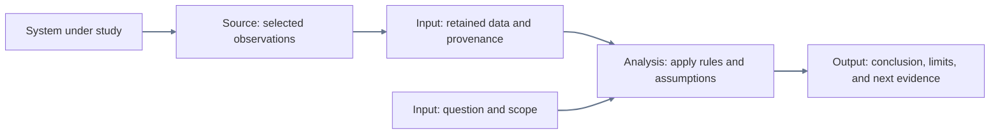

# How analysis tools reach conclusions

An analysis tool answers a question about a system using a representation of that system. A log, configuration export, measurement, or model captures some of what happened or could happen. The strength of the conclusion depends on how that representation was produced, what it covers, and whether the analysis method fits the question.

[Mermaid source](_references/diagrams/09-how-analysis-works/01-overview.mmd)

## What to check before trusting a result

| Check | Question to ask |
| --- | --- |
| Provenance | Which system produced the data, how was it collected, and which revision or time window does it describe? |
| Validity | Can the tool parse it, and do its fields mean what the analysis assumes? A valid timestamp can still come from the wrong clock. |
| Coverage | What could the source observe? What was sampled, filtered, omitted, or outside scope? |
| Method | What rules or assumptions turn the input into a conclusion? Can unsupported cases appear as ordinary results? |
| Corroboration | Is another source independent, or does it repeat data from the same system? What would a disagreement tell us? |
| Reproducibility | Can a reviewer recover the original inputs, tool version, and rule set and explain a change between runs? |

## Example: what does zero mean?

A warehouse dashboard shows zero out-of-stock events yesterday. That could reflect a day with no stockouts, a feed that stopped at noon, or a report that covers only one warehouse. Check the feed’s scope and time window before interpreting the count. If the relevant inputs are missing, report the question as unresolved and say which records would help answer it.

The same distinction applies to a service access log. A zero count in a sampled log describes that sample. A configuration model can establish a property of the configuration it represents. Observed behavior needs evidence from the running system. A useful analysis report makes each of those claims separately and cites the inputs behind it.

## How different methods contribute evidence

| Method | What it can establish | What to keep learning |
| --- | --- | --- |
| Source and configuration analysis | What a particular revision declares or allows under the modeled rules. | Which framework behaviors, deployment settings, or runtime facts are outside the model. |
| Vulnerability analysis | Whether evidence supports a specific security claim about a component in context. | Which prerequisites, affected versions, and impact assumptions matter, and what evidence could disprove the claim. |
| Human-led penetration testing | How deployed controls behaved in an authorized test from a recorded network and identity context. | Which paths and roles were exercised, which remained untested, and whether the observed behavior matches the expected control. |
| Log and telemetry review | What the configured source recorded over a known window. | How sampling, filtering, and missing telemetry limit conclusions. |
| Formal verification | Whether a stated property holds for the model under its assumptions. | How the implementation corresponds to the model and which real-world conditions it leaves out. |

## Worked lesson: two exports, one source

| Step | Record |
| --- | --- |
| Question | Does comparing an advertised REST index with the registered routes establish inventory completeness? |
| Evidence | The public index derives its entries from the registered route map. [WordPress index implementation](https://developer.wordpress.org/reference/classes/wp_rest_server/get_index/) |
| Limitation | Both exports share a source. They cannot independently account for routes observed at other layers. |
| Decision | Use the comparison to check visibility, scope, and import behavior. Keep broader web-surface coverage unresolved. |
| Follow-up check | Compare the core and plugin snapshots and verify that the report explains which source accounts for each change. **Benchmark pending.**[^benchmark] |

[^benchmark]: The [WordPress benchmark](../benchmarks/apps/wordpress/README.md) defines this check. Runnable inputs and results are pending.

See [Defensive security analysis research](07-defensive-analysis-research.md) for primary studies and [Evidence Evaluate](_tools/evidence-evaluate/README.md) for the proposed feedback workflow.

For the suite’s terminology and reporting conventions, see [Pensys glossary](glossary.md) and [Evidence readiness](06-tool-boundaries-and-evidence.md#evidence-readiness).
