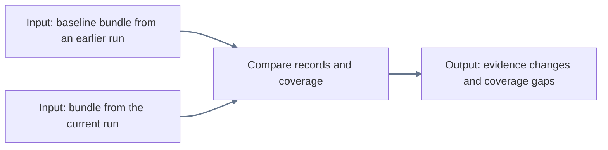

# Evidence Diff

**Design status: planned.**[^tool-status]

Compare compatible evidence from two runs and report what changed in observations, assessments, and coverage. Compare bundles within the same project and environment. For v1, match observations by exact subject and kind, and assessments by exact subject and claim, only when each key is unique on both sides and the producer and review context are comparable. Bundle-local record IDs are citation targets.

[Mermaid source](../../_references/diagrams/evidence-diff/01-overview.mmd)

Use the shared Evidence Validate library to check inputs before comparison.

Report unmatched or ambiguous records explicitly. If scope, freshness, or comparable inputs cannot be established, leave the comparison unresolved. Report a result as no longer evaluable when required inputs disappear. A resolution requires evidence from the current run.

See [Shared evidence schema](../../../schema/README.md) and [Evidence Validate](../evidence-validate/README.md).

[^tool-status]: This page describes intended behavior. See [suite implementation status](../../06-tool-boundaries-and-evidence.md) for what is available today.
