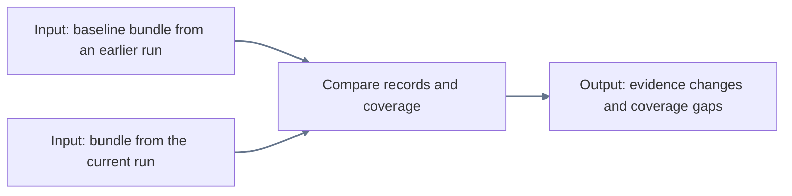

# Evidence Diff

**Design status: planned.**[^tool-status]

Compare compatible evidence from two runs and report what changed in observations, assessments, and coverage. Use comparable scope and stable subject identifiers to match records across runs.

[Mermaid source](../../_references/diagrams/evidence-diff/01-overview.mmd)

Use the shared Evidence Validate library to check inputs before comparison.

If a finding disappears and the current run lacks its input, report it as no longer evaluable. A resolution requires evidence from the current run.

See [Shared evidence schema](../../../schema/README.md) and [Evidence Validate](../evidence-validate/README.md).

[^tool-status]: This page describes intended behavior. See [suite implementation status](../../06-tool-boundaries-and-evidence.md) for what is available today.
