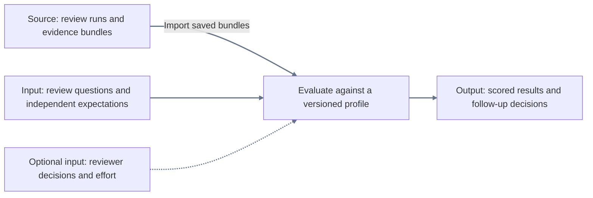
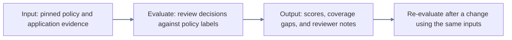

# Evidence Evaluate

**Proposed shared command:** `pensys evidence evaluate` applies a versioned evaluation profile to evidence bundles from any supported investigation.[^status] Dogfooding Pensys is one use. A review team could also use it to decide whether its exports, policies, or review steps provide enough evidence.

[Mermaid source](../../_references/diagrams/evidence-evaluate/01-overview.mmd)

| Responsibility | Planned command |
| --- | --- |
| Check structure, references, and scope | [Evidence Validate](../evidence-validate/README.md) |
| Show changes between compatible runs | [Evidence Diff](../evidence-diff/README.md) |
| Follow citations to their sources | [Evidence Trace](../../06-tool-boundaries-and-evidence.md#next-shared-commands) |
| Judge whether results meet independent expectations and record reviewer effort | Evidence Evaluate |

An evaluation profile names the review questions, compatible scope, scoring rules, and labeled examples where available. Save the profile revision, input bundle IDs, reviewer feedback, and resulting decision in a new run. Keep a manual review or prior workflow as a baseline when comparing approaches. Score an unresolved outcome when the independent expectation is that the evidence is insufficient. Mark cases without independent expectations as unscored. Report the scoring denominator, coverage, and reviewer effort so unresolved or unscored cases remain visible.

### Manual policy evaluation

[Mermaid source](../../_references/diagrams/evidence-evaluate/02-manual-policy-evaluation.mmd)

Start with one manual evaluation of the [policy benchmark](../../08-policy-verification-design.md). Capture what evidence the reviewer needed, which conclusions were correct or unresolved, and what should change next. Repeat on the same pinned inputs after a change. Add a reusable command once the scoring and record format work across a second bundle type, such as ingress. Tool-specific questions belong in profiles.

See [Tool boundaries and shared evidence](../../06-tool-boundaries-and-evidence.md).

[^status]: The command, profile format, and scoring rules are proposals. Each profile needs independent expectations before its results can support an accuracy claim.
