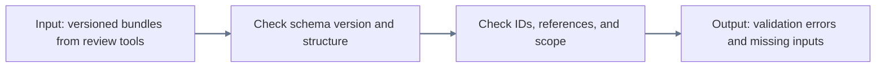

# Evidence Validate

**Design status: planned.**[^tool-status]

Check evidence bundles from any package before using them together. Validate the format, then check record IDs, references, and project and environment scope across the supplied bundles.

[Mermaid source](../../_references/diagrams/evidence-validate/01-overview.mmd)

Expose the validation checks as a library for Evidence Diff and Trace.

If an Origin Review bundle cites an Ingress Review record and the ingress bundle is absent, report the missing bundle. If the bundle is supplied but lacks the cited record, report a broken reference.

See [Shared evidence schema](../../../schema/README.md) and [Evidence Diff](../evidence-diff/README.md).

[^tool-status]: This page describes intended behavior. See [suite implementation status](../../06-tool-boundaries-and-evidence.md) for what is available today.
