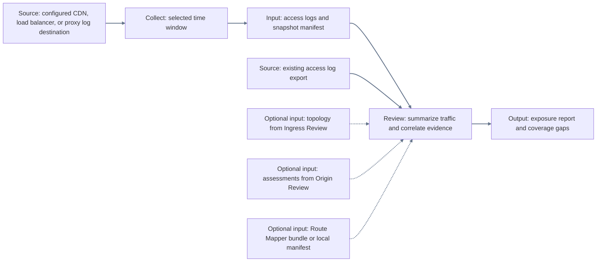

# Exposure review CLI

**Design status: planned.**[^tool-status]

Build a read-only CLI that compares observed edge traffic with deployed ingress and application routes for personal and work projects you own or are authorized to review. Traffic adapters normalize logs. Keep traffic parsing and aggregation in this package until a second consumer needs the same normalized records. Summarize traffic independently and report which correlations were unavailable when supporting inputs are missing.

[Mermaid source](../../_references/diagrams/exposure-review-cli/01-overview.mmd)

## Proposed package commands

- `exposure traffic` summarizes edge and gateway logs by request pattern, status, and whether the request was forwarded when that evidence is available.
- `exposure review` correlates traffic with available ingress, origin, and application route evidence. It highlights ingress assessments relevant to observed traffic, requests worth reviewing, and gaps in evidence.

## Provider inputs

- **AWS:** CloudFront and Application Load Balancer access logs.
- **Google Cloud:** External Application Load Balancer request logs.
- **Azure:** Front Door access logs.
- **Cloudflare:** Request logs where available.

Start with a local route manifest and log exports. **First cloud adapter: open.**[^adapter] AWS is a candidate for an AWS deployment. The input model should also support other providers, self-managed reverse proxy logs, and future honeypot summaries. Preserve provider and resource identifiers, log coverage windows, and route matching uncertainty.

## First review report

For each noteworthy request pattern, show the environment, edge, method, normalized route, count, time window, response evidence, and owner if known. A successful HTTP status alone leaves open what the response contained. Report possible unintended exposure separately from confirmed configuration findings and missing telemetry. Aggregate events without retaining request bodies, credentials, or query values by default.

## Related notes

- [Internet exposure](../../02-internet-exposure.md)
- [Origin protection controls](../../04-origin-protection-controls.md)
- [Distributed honeypot telemetry](../../05-distributed-honeypot.md)
- [Ingress Review CLI](../ingress-review-cli/README.md)
- [Tool boundaries and shared evidence](../../06-tool-boundaries-and-evidence.md)
- [Route Mapper](../route-mapper/README.md)

[^tool-status]: This page describes intended behavior. See [suite implementation status](../../06-tool-boundaries-and-evidence.md) for what is available today.

[^adapter]: Select the first adapter using an available export that can exercise the comparison and coverage rules.
