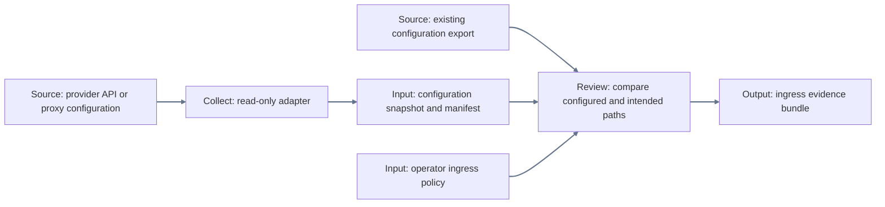

# Ingress Review CLI

**Design status: planned.**[^tool-status]

A read-only tool for checking whether deployed network paths match the intended ingress for a personal or work project. It compares local configuration exports with a small manifest of approved entry points and backends.

[Mermaid source](../../_references/diagrams/ingress-review-cli/01-overview.mmd)

## First version

- Accept a manifest with the environment, public listener, hostname, expected backend, and whether the backend should be private.
- Import configuration for one supported deployment pattern, such as CloudFront with an Application Load Balancer or a self-managed reverse proxy with a local backend. Later adapters can cover Google Cloud, Azure, and Cloudflare using the same path model.
- Model listener, routing, and backend access separately. Under `pensys internal ingress`, show the listener-to-backend inventory and report topology mismatches such as unexpected listener bindings or routes. Export network rules as observations for Origin Review to evaluate against its caller policy. Cite the resource and relevant rule for each finding.
- Keep intended configuration and deployed exports identifiable by source and timestamp. A configured path is evidence about the supplied rules. Its runtime behavior can be checked separately where needed.

## Example

The manifest says requests should enter through a public reverse proxy and the application should listen only on loopback. A deployed export shows that the application port is bound to all IPv4 interfaces. Report the binding mismatch. If firewall evidence is missing, leave public reachability unresolved.

The [Exposure Review CLI](../exposure-review-cli/README.md) can consume the versioned ingress evidence bundle alongside edge logs and application routes. See [Ingress](../../03-ingress.md) for deployment patterns.

See [Tool boundaries and shared evidence](../../06-tool-boundaries-and-evidence.md) for the interchange contract.

[^tool-status]: This page describes intended behavior. See [suite implementation status](../../06-tool-boundaries-and-evidence.md) for what is available today.
