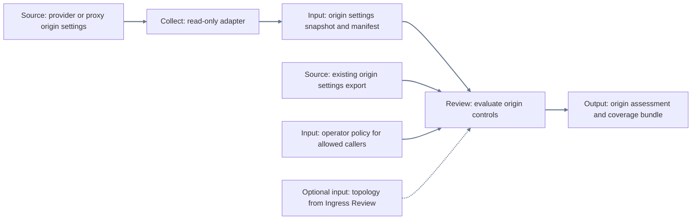
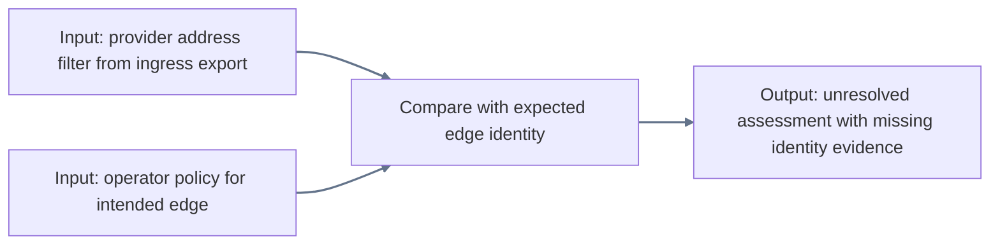

# Origin Review CLI

**Design status: planned.**[^tool-status]

Review whether a backend's configured access controls enforce the intended edge-to-origin trust boundary. Run locally against exported evidence for personal or work deployments.

[Mermaid source](../../_references/diagrams/origin-review-cli/01-overview.mmd)

## Package boundary

Ingress Review owns configuration parsing and topology, including listeners, routing, backend bindings, and network paths. Origin Review owns decisions about whether an origin's network restrictions and edge identity controls match policy. Ingress evidence can be supplied as a versioned file from the CLI or as a compatible local fixture. Edge Traffic Review can correlate either tool's evidence with routes and observed traffic.

Start with one control evaluator and offline exports. Provide `pensys internal origin` as a distinct command. If the evaluator ends up using the same inputs and rules as Ingress Review, ship both commands in one package while preserving their separate outputs. Record the origin, permitted edge, evidence for each required control, and any explicit exceptions such as private health checks or internal callers. Emit a supported assessment, a configuration mismatch, or an unresolved assessment with references to the underlying records. Treat configuration and observed runtime behavior as distinct evidence.

## Example: shared edge network

[Mermaid source](../../_references/diagrams/origin-review-cli/02-example-shared-edge-network.mmd)

A provider address filter narrows the network sources. If the policy requires the specific distribution or proxy to prove its identity, review the separate credential or provider-enforced restriction. If the export omits that configuration, report the missing input.

See [Origin protection controls](../../04-origin-protection-controls.md), [Ingress Review CLI](../ingress-review-cli/README.md), and [Tool boundaries and shared evidence](../../06-tool-boundaries-and-evidence.md).

[^tool-status]: This page describes intended behavior. See [suite implementation status](../../06-tool-boundaries-and-evidence.md) for what is available today.
