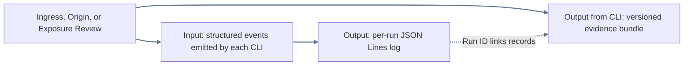
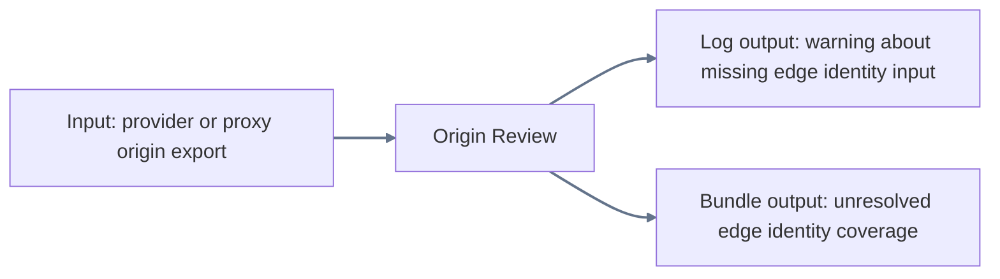

# Shared review log

**Design status: planned.**[^tool-status]

A shared logging package records what happened during a tool run. It accepts structured events from any review tool. Its file format can also be written by tools in other languages.

[Mermaid source](../../_references/diagrams/review-log/01-overview.mmd)

## What the package owns

| Output | Purpose | Example |
| --- | --- | --- |
| Run log | Explain which steps ran and where the run encountered problems. | An adapter imported a configuration export and reported a missing input. |
| Evidence bundle | Exchange observations, assessments, and coverage between tools. | The origin assessment cites a listener rule and records that edge identity is unresolved. |
| CLI report | Present tool-specific results to the operator. | Origin Review shows the affected backend and its unresolved control. |

Start with a small Python writer and a versioned JSON Lines format. Use one file per run so tools can run independently. Keep the terminal report on stdout and send optional human-readable diagnostics to stderr. Add a shared viewer or collector when there is a concrete need to search across runs.

Each event should include a timestamp, severity, tool name and version, run ID, event name, and concise message. Allow optional structured fields, such as a count, error category, or evidence bundle and record ID. Put the producing run ID in bundle metadata. Consumers should never need to parse log messages to recover findings.

## Example: incomplete origin export

[Mermaid source](../../_references/diagrams/review-log/02-example-incomplete-origin-export.mmd)

The tool chooses which events to emit. The shared writer serializes them consistently. Use allowlisted fields and omit credentials, request bodies, and raw configurations by default. Store run logs locally with project-appropriate access and retention.

See [Tool boundaries and shared evidence](../../06-tool-boundaries-and-evidence.md).

[^tool-status]: This page describes intended behavior. See [suite implementation status](../../06-tool-boundaries-and-evidence.md) for what is available today.
