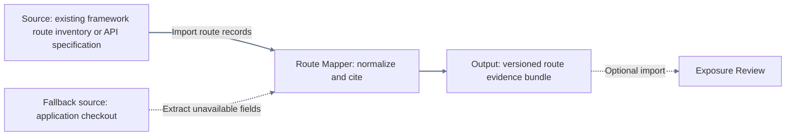
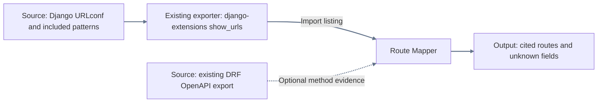
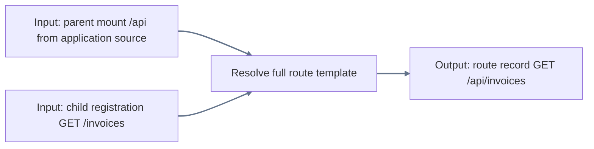

# Route Mapper

**Design status: planned.**[^tool-status]

Route Mapper imports existing framework inventories and API specifications, normalizes usable fields, and records their provenance. Prefer an existing export or framework registry before adding source analysis. Use static extraction for offline projects or fields the existing source cannot provide, and record unresolved registrations.

[Mermaid source](../../_references/diagrams/route-mapper/01-overview.mmd)

Each record carries the application scope, path template, method and handler when known, and a source reference with the revision or export timestamp. Record permission declarations as observations when available. Authorization decisions belong to a separate review. Exposure Review matches observed requests to route templates. Ingress Review supplies the gateway path and any rewrites needed to make that match.

## What existing tools expose

| Source | What it gives us | What Pensys adds |
| --- | --- | --- |
| Django URLconf or django-extensions `show_urls` | Django resolves registered URL patterns, including nested includes. The optional `show_urls` command lists project URLs and views. | Import paths and handlers with provenance. Leave HTTP methods unknown when the listing supplies no method evidence. |
| Django REST Framework routers or an existing OpenAPI export | Routers generate URL patterns from registered viewsets. OpenAPI paths describe documented HTTP operations within the schema's scope. | Use operation records for method evidence and retain the schema's scope. A schema may omit routes, and a URL listing may include pages outside the API. |
| Go chi router | `chi.Walk` visits routes with methods, patterns, and handlers. | Accept an application-provided export of those records. |
| Vue Router | `getRoutes()` returns browser-side route records. | Label these as client navigation. Backend API evidence comes from sources such as an API specification or captured client requests. |

[Django URL dispatcher](https://docs.djangoproject.com/en/6.0/topics/http/urls/), [django-extensions commands](https://django-extensions.readthedocs.io/en/latest/command_extensions.html), [DRF routers](https://www.django-rest-framework.org/api-guide/routers/), [DRF schemas](https://www.django-rest-framework.org/api-guide/schemas/), [Go chi Walk](https://pkg.go.dev/github.com/go-chi/chi/v5#Walk), [Vue Router getRoutes](https://router.vuejs.org/api/interfaces/Router.html#getroutes)

## Example: Django route evidence

[Mermaid source](../../_references/diagrams/route-mapper/03-example-django-route-evidence.mmd)

Start by importing an existing operator-provided listing or OpenAPI file. Record the settings profile or schema scope when known. The import can run offline. Route Mapper adds a small framework adapter when an export needs normalization or the application needs a way to serialize its registry.

## Example: nested route registration

[Mermaid source](../../_references/diagrams/route-mapper/02-example-nested-route-registration.mmd)

If the adapter cannot resolve a mount prefix, preserve the known child route and record the unresolved registration in coverage.

See [Tool boundaries and shared evidence](../../06-tool-boundaries-and-evidence.md) and [Exposure Review CLI](../exposure-review-cli/README.md).

[^tool-status]: This page describes intended behavior. See [suite implementation status](../../06-tool-boundaries-and-evidence.md) for what is available today.
