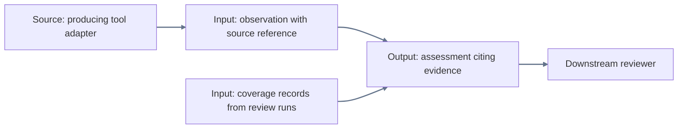
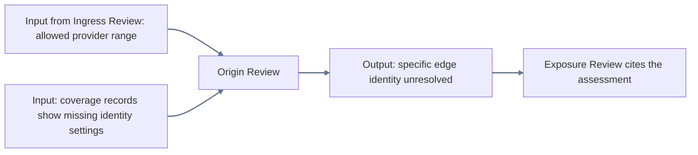

# Schema patterns from Trace and security-audit-skill

Trace shows how to preserve where an imported record came from. The security audit skill shows how to record a verdict and account for what a review covered. Both patterns fit the evidence exchanged by our CLI packages.

[Mermaid source](../../_references/diagrams/schema/01-overview.mmd)

| Reference | Pattern to adopt | Application |
| --- | --- | --- |
| Trace | Adapters normalize into a common import batch. Imported relationships default to candidate status, and the planner links duplicates to existing records. | Give every observation a source reference. Treat cross-tool joins as inferred where identifiers are ambiguous. Preserve a reason and count for unmapped inputs and leave raw records in their original store. |
| security-audit-skill | Separate findings validation from coverage validation. Unresolved findings carry blockers, and rejected candidates carry reasons. | Give unresolved origin or exposure assessments a specific missing fact. Track which resources and time windows each CLI reviewed. Scope confirmed assessments to the claim the evidence actually supports. |

[Trace import model](https://github.com/phil-markarian/Trace/blob/7b49d40e0edfefc3b8fab450496f6af0bc68df42/src/services/import/types.ts), [Trace import planner](https://github.com/phil-markarian/Trace/blob/7b49d40e0edfefc3b8fab450496f6af0bc68df42/src/services/import/plan.ts), [Audit findings schema](https://github.com/phil-markarian/security-audit-skill/blob/c1c8a8c1471069fb0e188eeaff69b8e8db6564a8/skills/security-audit/report-schema.json), [Audit coverage validator](https://github.com/phil-markarian/security-audit-skill/blob/c1c8a8c1471069fb0e188eeaff69b8e8db6564a8/skills/security-audit/validate-coverage-ledger.cjs)

## Adopted patterns and open extensions

| Pattern | What to borrow | Where it belongs |
| --- | --- | --- |
| Review workspace | Trace keeps a local case and supports exporting it. Define a project manifest that lists scope and bundle locations so a review can be reopened or shared. | Agreed for the [suite wrapper](../../06-tool-boundaries-and-evidence.md#review-workspace). |
| Evidence inspection | Trace lets readers follow relationships to their sources. Use `pensys evidence trace <assessment-id>` to follow citations to their source records and identify missing inputs. **Direct record lookup** is a possible extension.[^lookup] | Shared evidence commands, alongside Validate and Diff.  |
| Evidence freshness | The audit skill rechecks prior records when relevant source or conditions change. Track input revisions or snapshot IDs so Diff can show which earlier assessments need a fresh review. | Shared metadata and Evidence Diff. Keep the original assessment available as history. |

[Trace workspace and case exports](https://github.com/phil-markarian/Trace/blob/7b49d40e0edfefc3b8fab450496f6af0bc68df42/README.md#local-first), [Trace read-only queries](https://github.com/phil-markarian/Trace/blob/7b49d40e0edfefc3b8fab450496f6af0bc68df42/docs/MCP.md), [Audit skill prior-run handling](https://github.com/phil-markarian/security-audit-skill/blob/c1c8a8c1471069fb0e188eeaff69b8e8db6564a8/skills/security-audit/RECONNAISSANCE.md#prior-run-input)

## Example: origin identity is unresolved

[Mermaid source](../../_references/diagrams/schema/02-example-origin-identity-is-unresolved.mmd)

Start with a versioned bundle envelope for observations, assessments, and coverage. Validate the structure at import and export. Check record references and project or environment scope when combining bundles. Share a fixture for this example so each tool can test against the same contract independently.

See [Tool boundaries and shared evidence](../../06-tool-boundaries-and-evidence.md).

The [v1 schema and fixtures](../../../schema/README.md) capture the example above.

[^lookup]: The agreed inspection command is `pensys evidence trace`. A separate `show` command and UI depend on demand.
